# ROADMAP.md — open work items

<!-- GENERATED FILE — DO NOT EDIT BY HAND. Regenerate with `roadmap sync`. -->

This is the agent-readable projection of the roadmap graph; the store is the `roadmap_items` table (see `roadmap/README.md`). For when it was last regenerated ask git — `git log -1 --format=%cI -- roadmap/ROADMAP.md` — because nothing in this file is derived from the clock or from a graph-wide total, so that two branches editing different items merge cleanly. Do not add one back.

`ARCS.md` is the narrative layer — *why* an arc is open. This file is the work-item layer — *what* is claimable right now, and who holds it.

## ▶ Ready — startable now

Claim before starting: `roadmap claim <key>`

**In priority order, most important first.** An item with no marker carries no stated priority — take it as unjudged, not as low. The order within a band is alphabetical and means nothing.

- `now` **`colab-block-collapse`** — A Colab lesson block shows only its step line and one open action; the how-to and alternatives fold into "עזרה וחלופות"
- `now` **`unteamed-students-need-instructor-approved-auto-assign`** — After teams lock, propose teams for unteamed students and apply them only on the instructor's approval
  - ↔ related: **`team-formation-closes-at-a-deadline`** — Builds on the deadline lock from #13: that item lists unteamed students but leaves placing them to the instructor, one dropdown at a time.
- `later` **`retire-bonus-points-phase-2-drop-column`** — enrollments.bonus_points is zeroed but still in the schema
- `later` **`roster-reimport-email-conflicts-are-not-shown`** — Roster re-import reports email conflicts that the UI never shows
- `later` **`suggest-rubrics-per-assignment-from-clusters`** — Suggest a rubric for a new assignment from clusters of past rubrics
- `later` **`unreleasing-a-peer-round-keeps-its-gradebook-scores`** — Un-releasing a peer round leaves its applied scores in the gradebook

## ⏸ Deferred — startable, deliberately not now

_Nothing deferred._

## 🔒 Claimed — someone is on these

| item | held by | since |
|---|---|---|
| `class-insights-update-live` | claude/practical-ride-d2lxpj | 2026-11-04T00:00:00Z |
| `exit-check-no-chatbot` | claude/exit-check-no-chatbot | 2026-11-03T19:00:00Z |
| `exit-checks-concrete` | claude/exit-checks-concrete | 2026-11-03T21:00:00Z |
| `instructor-course-page-is-organized-as-fake-steps` | claude/practical-ride-d2lxpj | 2026-11-03T00:00:00Z |
| `instructor-pages-are-walls-of-text` | claude/practical-ride-d2lxpj | 2026-11-03T00:00:00Z |
| `lesson-3-restructure-two-parts` | claude/lesson-3-restructure-two-parts | 2026-11-03T18:20:00Z |
| `lesson-4-harness-and-fixes` | claude/lesson-4-coding-agent | 2026-11-10T19:30:00Z |
| `lesson-title-sync-on-install` | claude/exit-check-no-chatbot | 2026-11-03T19:15:00Z |
| `notebooks-per-step` | claude/notebooks-per-step | 2026-11-03T19:35:00Z |
| `lesson-complete-celebration` | claude/lesson-complete-celebration | 2026-11-03T00:00:00Z |

A claim's only trace is this row, so a session that merged or died leaves its hold behind forever and the item silently stops being offered to anyone. If **since** is more than 3 days ago, check whether that branch still has work in flight before assuming the hold is live — if it is merged or gone, `roadmap release <key>`.

## ⛔ Blocked

_Nothing blocked._

## Dependency graph

```mermaid
graph TD
  classDef ready stroke:#2da44e,stroke-width:2px
  classDef deferred stroke:#9a6700,stroke-width:1px,stroke-dasharray:4 3
  classDef blocked stroke:#cf222e,stroke-width:2px
  classDef claimed stroke:#8250df,stroke-width:2px
  classDef verifying stroke:#0969da,stroke-width:2px,stroke-dasharray:6 3
  classDef done stroke:#8c959f,stroke-width:1px,stroke-dasharray:5 4
  assignments_need_custom_rubrics["✓ Assignments are graded on one fixed rubric instead of rubrics that fit the task"]:::done
  autograder_needs_a_proper_redesign["✓ The notebook autograder needs a proper redesign, once there is enough graded data"]:::done
  class_insights_update_live["Class insights only refresh by hand or on an opt-in 30-second timer"]:::claimed
  colab_block_collapse["A Colab lesson block shows only its step line and one open action; the how-to and alternatives fold into 'עזרה וחלופות'"]:::ready
  course_42052_whole_syllabus["✓ The 42052 course exists only as one guided lesson; the other 12 sessions, the schedule and readiness are missing, and lesson 2's answer keys sit in a public repository"]:::done
  courses_and_submissions_cannot_be_deleted["✓ Courses, assignments and submissions can't be deleted or archived"]:::done
  exit_check_no_chatbot["Every lesson's exit check ends by sending students to a chatbot to challenge their explanation, a chatbot task with no reason"]:::claimed
  exit_checks_concrete["Every lesson's exit check asks the same generic 'explain what you tried, saw and still don't know', and students don't know what it wants"]:::claimed
  frontend_has_no_tests["✓ The frontend has no tests; CI only type-checks it"]:::done
  hebrew_report_pdfs_cannot_be_downloaded["✓ Hebrew student report PDFs are queued but can never be retrieved from the hosted site"]:::done
  instructor_course_page_is_organized_as_fake_steps["The instructor course page is eight numbered 'steps' that aren't steps, with student tools in three places"]:::claimed
  instructor_pages_are_walls_of_text["Instructor and student pages are walls of text, with no sign of what needs attention"]:::claimed
  lesson_3_how_language_models_work["✓ Lesson 3 (how language models work) is only a three-step seed, with no runnable demo, no chatbot exercises and no notebook, and it is the next class session"]:::done
  lesson_3_part_b_deeper["✓ Lesson 3 teaches tokens, prediction and grounding but not neural networks, embeddings or transformers, and none of it is hands-on in the browser"]:::done
  lesson_3_restructure_two_parts["Session 3 sends students to a chatbot to learn instead of teaching on the page, uses weights and parameters before neural networks are taught, and frames its second half as optional"]:::claimed
  lesson_3_review_fixes["✓ Lessons 3 and 3-deeper state a few things that are not true (majority probability, chatbot sizes, one repeating layer, why the embedding model pairs translations)"]:::done
  lesson_4_coding_agent["✓ Lesson 4 (coding agent, from plan to run and check) is only a three-step seed, with no hands-on tool steps, no starter project and no runnable check"]:::done
  lesson_4_harness_and_fixes["Lesson 4 never explains how a coding agent works inside (turn, harness, tool requests, permissions), and its review found six blocking text errors in Antigravity facts and concept order"]:::claimed
  lesson_5_product_definition["Lesson 5 (defining a small business product) is only a four-step seed, with no team activity, no spec template and no architecture practice"]:::verifying
  lesson_6_skeleton["Lesson 6 (building a skeleton that works end to end) is only a four-step seed, with no agent scaffolding, no GitHub team routine and no README a stranger can run"]:::verifying
  lesson_complete_celebration["Finishing a lesson gets a short celebration and a clear way back to the lessons and the course page"]:::claimed
  lesson_title_sync_on_install["Re-importing a lesson fixture never updates the lesson's title, so live course 3 still shows the old titles"]:::claimed
  lessons_one_page_per_lesson["The instructor's Lessons section stacks every lesson's full card, the course plan's readiness table and the answer keys on one page"]:::verifying
  no_button_to_recheck_site_links["✓ Add a 're-check all links' button for a round"]:::done
  notebooks_per_step["Each lesson-3 part sends every Colab step to one long notebook, and a Colab step has no one-click link to its notebook"]:::claimed
  onboarding_guide_has_todo_sections["✓ ONBOARDING.md still has _TODO_ under Team Tips and Get Started"]:::done
  peer_round_scores_never_reach_the_gradebook["✓ Peer-review round scores have to be copied into the gradebook by hand"]:::done
  project_bonus_has_no_editor["✓ The per-student project bonus can't be edited directly"]:::done
  readme_describes_a_localhost_only_app["✓ README still says 'no login, localhost-only' and leaves out recent features"]:::done
  retire_bonus_points_phase_2_drop_column["enrollments.bonus_points is zeroed but still in the schema"]:::ready
  roster_cannot_be_edited_per_student["✓ Add, remove, withdraw or fix a single student without re-importing the roster"]:::done
  roster_reimport_email_conflicts_are_not_shown["Roster re-import reports email conflicts that the UI never shows"]:::ready
  student_portal_is_one_long_scroll["✓ The student portal is one long scroll with no navigation"]:::done
  students_cannot_see_their_own_grades["✓ Students cannot see their own grades, feedback or attendance status"]:::done
  students_need_an_assignment_page["✓ Students have no page for an assignment"]:::done
  suggest_rubrics_per_assignment_from_clusters["Suggest a rubric for a new assignment from clusters of past rubrics"]:::ready
  team_formation_closes_at_a_deadline["✓ Let students form their own teams until a deadline, then lock teams automatically"]:::done
  unreleasing_a_peer_round_keeps_its_gradebook_scores["Un-releasing a peer round leaves its applied scores in the gradebook"]:::ready
  unteamed_students_need_instructor_approved_auto_assign["After teams lock, propose teams for unteamed students and apply them only on the instructor's approval"]:::ready
  course_42052_whole_syllabus --> lesson_3_how_language_models_work
  lesson_3_how_language_models_work --> lesson_3_part_b_deeper
  course_42052_whole_syllabus --> lesson_4_coding_agent
  lesson_4_coding_agent --> lesson_5_product_definition
  lesson_5_product_definition --> lesson_6_skeleton
  exit_check_no_chatbot --> notebooks_per_step
  assignments_need_custom_rubrics --> suggest_rubrics_per_assignment_from_clusters
  peer_round_scores_never_reach_the_gradebook -.- project_bonus_has_no_editor
  roster_cannot_be_edited_per_student -.- team_formation_closes_at_a_deadline
  team_formation_closes_at_a_deadline -.- unteamed_students_need_instructor_approved_auto_assign
```

## Items

### `assignments-need-custom-rubrics`

- **title:** Assignments are graded on one fixed rubric instead of rubrics that fit the task
- **status:** done
- **priority:** now
- **blocks:** `suggest-rubrics-per-assignment-from-clusters`
- **refs:**
  - `backend/app/services/scoring.py`
  - `backend/app/services/code_metrics.py`
  - `backend/app/services/llm_code_review.py`
  - `backend/app/tasks/jobs.py`
  - `backend/app/models/entities.py`
  - `backend/app/services/student_grades.py`

evidence

> Operator, 2026-10-21: "Rubrics need to fit the actual task. for now we can
> simply add custom rubrics. later we would cluster among those rubrics and
> offer rubrics per assignment."
>
> VERIFIED by reading the code at 5b530b6. HW2 and project code are scored
> on the same twelve dimensions for every assignment
> (scoring.py:38 CODE_DIMENSIONS, weights fixed in code). Ten come from
> deterministic counting rules (code_metrics.py:402
> all_deterministic_scores) and english_comments; two are scored by the LLM
> from a fixed list (llm_code_review.py:28 CODE_REVIEW_DIMENSIONS, system
> prompt cached at :142, called from jobs.py:345). Each 0-5 score goes
> through the course's per-dimension curve (scoring.py:119 apply_curve,
> applied at jobs.py:361) and the component is multiplied by the run-ratio
> penalty (notebook_runner.py:121, scoring.py:305, :486). An assignment
> (entities.py:92) has no way to say what it should be graded on.
>
> Phase 1 only: custom rubrics stored as structured criteria rows, the
> LLM scoring each criterion with the deterministic metrics as evidence,
> instructor overrides, the gradebook using the rubric. Clustering is
> suggest-rubrics-per-assignment-from-clusters.
>
> Done when: an instructor can author a rubric for an assignment (create,
> edit, reorder, delete, copy from another assignment), run the autograder,
> see per-criterion LLM scores with rationales citing cells, override them
> (overrides survive re-runs), and the gradebook total for that assignment
> comes from the rubric. An LLM failure leaves criteria "not scored" and
> the run still succeeds. Assignments without a custom rubric score exactly
> as before, proven by a regression test.
>
> SHIPPED: #26, merged as 62ba0ae.

### `autograder-needs-a-proper-redesign`

- **title:** The notebook autograder needs a proper redesign, once there is enough graded data
- **status:** done
- **priority:** later
- **refs:**
  - `backend/app/services/notebook_runner.py`
  - `backend/app/services/code_metrics.py`
  - `backend/app/services/llm_code_review.py`
  - `backend/app/services/llm_review.py`
  - `backend/app/services/scoring.py`

evidence

> Operator, 2026-10-20: "we need to do the auto grader properly. but we do
> it when we have more data."
>
> Today HW2 and project code are scored by this app's notebook autograder:
> the notebook is run, code metrics plus an LLM review are mapped to a
> rubric, then a course curve and a run-ratio penalty are applied
> (notebook_runner, code_metrics, llm_code_review, scoring.apply_curve).
> Since #15, its score is also the 70% part of any task a peer round
> feeds.
>
> DEFERRED until there is enough real graded data (submissions with
> autograder scores next to the instructor's own judgement) to design and
> check against. What "properly" means isn't defined yet. Start with the
> operator: what is wrong with today's scores, and what the grade should
> reward.
>
> Done when: scoped with the operator against real data, and replaced by
> concrete items.
>
> SUPERSEDED 2026-10-21: the operator asked for the rebuild now. Phase 1 is
> assignments-need-custom-rubrics (#26); phase 2 is
> suggest-rubrics-per-assignment-from-clusters (deferred).

### `class-insights-update-live`

- **title:** Class insights only refresh by hand or on an opt-in 30-second timer
- **status:** claimed
- **priority:** now
- **claimed by:** claude/practical-ride-d2lxpj (since 2026-11-04T00:00:00Z)
- **refs:**
  - `frontend/components/lessons/instructor-lessons.tsx`
  - `backend/app/services/lessons.py`
  - `backend/app/api/lessons.py`
  - `backend/tests/unit/test_lessons.py`
  - `frontend/e2e/insights-live.spec.ts`

evidence

> The operator, 2026-11-04: "I want the insights to update live".
>
> VERIFIED at defbde8. InsightsPanel (frontend/components/lessons/
> instructor-lessons.tsx) loads once, and refreshes only on "↻ Refresh" or
> an opt-in "Refresh every 30 s" checkbox, off by default
> (AUTO_REFRESH_MS = 30_000). The insights endpoint recomputes everything on
> each call (services/lessons.py insights(): every enrollment's progress,
> attempts, experiments and commitments, plus every free-text answer in the
> payload), so polling it every few seconds would cost a full computation
> per tick for each instructor tab, busy or not. The student drawer fetches
> once when opened and never again.
>
> Done when: the insights update on their own while the page is open and
> visible, on by default, with a Live / Paused toggle; the page asks a
> cheap stamp (GET …/lessons/{id}/insights/stamp, aggregates only) every few
> seconds and refetches the insights only when it moves, at most every 10 s
> while the class is busy; a hidden tab asks nothing and checks again when
> shown; a failing check backs off and says so; an open student drawer
> refreshes in place; the stamp moves on every write the insights show
> (progress and drafts, answers, review flags, experiments, commitments,
> withdrawals, answer keys) and not on reads or on another course's
> activity (backend test); and a browser test shows a student's step
> reaching an open insights page without a reload, and a paused page
> asking nothing.

### `colab-block-collapse`

- **title:** A Colab lesson block shows only its step line and one open action; the how-to and alternatives fold into "עזרה וחלופות"
- **status:** ready
- **priority:** now
- **refs:**
  - `frontend/components/lessons/blocks.tsx`
  - `frontend/e2e/colab-block.spec.ts`

evidence

> REQUESTED by the operator, looking at the live site: "in the lesson block
> for colab, collapse any generic instructions or alternatives, basically
> just show the open in colab button uncollapsed".
>
> At 1fac480 `ColabBlock` (frontend/components/lessons/blocks.tsx) renders
> everything open: the "פתיחה בקולאב" button (when the lesson has a
> colab_url), a "if it doesn't open" note, the full numbered instruction
> list (download, upload, sign in, run ▶, CPU), the download button and a
> colab.research.google.com link.
>
> Done when, through the shared renderer (no content or notebook change):
>   1. Visible: the block heading (step line) and ONE primary action — the
>      instructor's colab_url button where set, otherwise the .ipynb
>      download. Nothing else.
>   2. Everything else, including the return note and the download when
>      it is secondary, is in
>      one native 
 "עזרה וחלופות", collapsed by default and
>      keyboard-operable. Nothing is dropped.
>   3. An e2e covers lesson-03 preview (download primary) and lesson 2 with
>      an injected Drive colab_url (link visible; all 5 instructions, the
>      download and colab.research.google.com inside the expander).

### `course-42052-whole-syllabus`

- **title:** The 42052 course exists only as one guided lesson; the other 12 sessions, the schedule and readiness are missing, and lesson 2's answer keys sit in a public repository
- **status:** done
- **priority:** now
- **blocks:** `lesson-3-how-language-models-work`, `lesson-4-coding-agent`
- **refs:**
  - `content/course-42052/COURSE-HANDOFF.txt`
  - `backend/app/lessons/schema.py`
  - `backend/app/lessons/content/lesson-2.json`
  - `backend/app/services/lessons.py`
  - `frontend/components/lessons/instructor-lessons.tsx`

evidence

> Operator, 2026-10-27: implement the whole-course handoff
> (content/course-42052, merged with this PR's base) in the existing lesson
> engine (#22). Private fields (39 checks' correct_choice_id and
> feedback_he, instructor.email) were removed from the handoff; they live in
> the database, never in the repository, which is public.
>
> VERIFIED at 75f4b90. The app has one lesson fixture, lesson-2.json, and it
> embeds every question's answer key (correct, feedback, misconceptions,
> explanation). Nothing models the 13 sessions, presentation rounds or
> per-lesson readiness.
>
> Phase 1 (this item): the 13 topic slots and seeds as draft lessons in the
> existing schema (extended, not forked); a plan of 13 sessions with rounds
> in 2-3, 4-5, 6-7, 8-9 and finals in 12-13, inventing no dates, rooms,
> teams, slots or deadlines; private answer keys and the instructor contact
> in the database, loaded by an instructor-only upload or a local script;
> lesson 2's keys moved out with a one-time export; publishing blocked and a
> warning shown while keys are missing; a readiness table keeping drafted /
> reviewed / runnable / published / live verified apart. The grade formula
> is not touched (the syllabus' 50/30/20 differs from the app: operator's
> call).
>
> Done when: all 13 lessons import as drafts and preview in Hebrew RTL on
> desktop and phone; keys load from the private file and are never in a
> student response before an answer (tested on every student lesson
> endpoint and /api/r/<token>); lesson 2 works with its keys in the
> database; the readiness table renders; CI is green.
>
> Later phases, not in this item: runnable exercises and notebooks for
> lessons 3-13 per readiness.json, and homework briefs.
>
> SHIPPED: #29, merged as 161530d.

### `courses-and-submissions-cannot-be-deleted`

- **title:** Courses, assignments and submissions can't be deleted or archived
- **status:** done
- **priority:** later
- **refs:**
  - `backend/app/api/courses.py`
  - `backend/app/api/submissions.py`
  - `frontend/app/page.tsx`

evidence

> VERIFIED by grep for `@router.delete` at dfdfa01. The only delete routes are
> for the instructor session, teams, snapshots and overrides.
>
> A test course or a mistaken ZIP import stays forever. There's also no way to
> remove a student from a submission's group when the filename parser grouped
> them wrongly.
>
> Done when: a course can be archived (hidden from the home page, still
> restorable); a submission can be deleted, with its artifacts removed from
> storage; and group membership on a submission can be edited.
>
> SHIPPED: #18, merged as ab89251 and deployed 2026-10-20 (Vercel green, health 200).

### `exit-check-no-chatbot`

- **title:** Every lesson's exit check ends by sending students to a chatbot to challenge their explanation, a chatbot task with no reason
- **status:** claimed
- **priority:** now
- **claimed by:** claude/exit-check-no-chatbot (since 2026-11-03T19:00:00Z)
- **blocks:** `notebooks-per-step`
- **refs:**
  - `content/course-42052/lessons/`
  - `backend/app/lessons/content/course-42052/`
  - `content/course-42052/START-HERE.txt`

evidence

> Operator rule, 2026-11-03: no chatbot task without a reason (Reed's #41
> N1). VERIFIED at 1fac480: the exit check of every 42052 lesson (seeds
> lesson-01..13 and the built lessons, plus lesson-03-deeper) ends "ענו
> תחילה בעצמכם, ואז אפשר לבקש מהצ׳טבוט לאתגר את ההסבר." Lesson 5 also has
> an optional "find more hard test cases" chatbot prompt in its SPEC examples
> step, which has a stated job and stays.
>
> This item: the sentence removed from all seeds and built lessons (generated
> ones rebuilt from the seeds), the rule recorded in START-HERE.txt, and a
> whole-course test that it stays gone.

### `exit-checks-concrete`

- **title:** Every lesson's exit check asks the same generic "explain what you tried, saw and still don't know", and students don't know what it wants
- **status:** claimed
- **priority:** now
- **claimed by:** claude/exit-checks-concrete (since 2026-11-03T21:00:00Z)
- **refs:**
  - `content/course-42052/lessons/`
  - `backend/app/lessons/content/course-42052/`
  - `backend/app/lessons/course_plan.py`
  - `content/course-42052/START-HERE.txt`

evidence

> Operator, 2026-11-03: "בדיקת יציאה question - I don't understand what it
> wants". VERIFIED at c5ca5c5: every 42052 seed (lesson-01..13) and every
> built lesson except lesson-03-deeper asks the same generic "הסבירו במילים
> שלכם מה ניסיתם, מה ראיתם ומה עדיין אינו ידוע.", under the title "בדיקת
> יציאה" (set in course_plan._LABELS for generated lessons, by hand in the
> authored 03, 03-deeper, 04, 05). The live lesson-2 fixture
> (from-data-to-prediction) has no such question.
>
> This item: each lesson gets its own concrete question (the operator's
> wording, verbatim), the title becomes "לסיום: במילים שלכם" with one helper
> line saying the answer is short and ungraded, question ids unchanged; the
> rule recorded in START-HERE.txt; a whole-course test that pins every prompt
> and that no seed or built lesson keeps the generic prompt or the old title.

### `frontend-has-no-tests`

- **title:** The frontend has no tests; CI only type-checks it
- **status:** done
- **priority:** later
- **refs:**
  - `.github/workflows/ci.yml`
  - `frontend/app/course/[id]/submission/[submissionId]/page.tsx`
  - `frontend/app/course/[id]/page.tsx`
  - `frontend/components/student-view.tsx`

evidence

> VERIFIED at dfdfa01. The frontend job in ci.yml runs `npm ci` and
> `npx tsc --noEmit`, and nothing else. The submission review page (about
> 2,500 lines), the course page (about 1,900), the peer-review step (about
> 2,100) and the student view (about 1,200) have no tests.
>
> Done when: CI runs at least a Playwright smoke test that loads the
> instructor course page and the student review page against a seeded
> backend. Chromium is already available in the cloud sessions.
>
> SHIPPED: #19, merged as 44c8e7b and deployed 2026-10-20 (Vercel green, health 200).

### `hebrew-report-pdfs-cannot-be-downloaded`

- **title:** Hebrew student report PDFs are queued but can never be retrieved from the hosted site
- **status:** done
- **priority:** now
- **refs:**
  - `frontend/app/course/[id]/page.tsx`
  - `backend/app/services/exporter.py`
  - `backend/app/api/exports.py`
  - `backend/app/tasks/jobs.py`

evidence

> VERIFIED by reading the code at dfdfa01.
>
> "Queue Hebrew PDFs" (course page, gradebook step) POSTs
> `/api/courses/{id}/exports/student-reports?async_job=true`, shows a
> "Student reports queued" toast, and stops. The response's `task_id` is
> discarded; nothing in the frontend calls `GET /api/tasks/{task_id}`, so the
> instructor never learns whether the job finished or failed.
>
> Worse, `export_student_reports_hebrew` writes the PDFs with
> `export_path(...) / "student_reports"`, i.e. to local disk under
> `./data/exports/` on whichever machine runs the worker. They are never put in
> storage, so with `STORAGE_BACKEND=supabase` (the hosted setup) the instructor
> has no way to get them from the site at all.
>
> Done when: the worker stores the PDFs (one zip is fine) through
> `services/storage.py`; the gradebook polls the task and shows done / failed;
> and a done export offers a download link that works on the hosted site.
>
> SHIPPED: #12, merged as 1acc71f and deployed 2026-10-20 (Vercel green, health 200).

### `instructor-course-page-is-organized-as-fake-steps`

- **title:** The instructor course page is eight numbered "steps" that aren't steps, with student tools in three places
- **status:** claimed
- **priority:** now
- **claimed by:** claude/practical-ride-d2lxpj (since 2026-11-03T00:00:00Z)
- **refs:**
  - `frontend/app/course/[id]/page.tsx`
  - `frontend/app/page.tsx`
  - `frontend/components/peer-review/peer-review-step.tsx`
  - `frontend/app/course/[id]/submission/[submissionId]/page.tsx`
  - `frontend/app/course/[id]/student-view/page.tsx`
  - `frontend/e2e/teams.spec.ts`
  - `frontend/e2e/smoke.spec.ts`

evidence

> VERIFIED at b03bb04. The course page sidebar (frontend/app/course/[id]/
> page.tsx:136 `STEPS`) numbers eight items and the header says "Step N of
> 8", but only part of it is a sequence: Lessons, Peer review and Course
> settings are not steps, and step 1 (Grading queue) comes before step 2
> (Imports), whose own hint says "Start here at the beginning of the term".
> The cross-references disagree with the sidebar: the home page hint
> (frontend/app/page.tsx:143) lists "six steps: Imports → Queue → Curve →
> Overrides → Gradebook → Settings"; the gradebook hint (:1547) says "the
> curve in step 3, or add an override in step 4" (they are 5 and 6); the
> rubric hint on the submission page (:1466) says "the curve in step 3".
>
> Everything about students is split three ways: the roster upload and the
> add/edit/withdraw card are under Imports; sign-in accounts, teams and the
> personal portal links are under Peer review → Teams & links (the links
> open the whole portal — grades, team, lessons — not only reviews); "View
> as student" is a button in the peer-review tab bar. Assignment ZIPs, the
> only thing that fills the grading queue, are imported on a different page
> from the queue.
>
> The open step is kept in localStorage under one key for every course
> (`cg-course-step`, :162), not in the URL, so no section can be linked,
> back/forward doesn't move between sections, and opening course B lands on
> whatever step was last open in course A. teams.spec.ts has to plant that
> key to reach Peer review. The sidebar footer always says "Localhost · No
> auth needed", also on the hosted app; the Archive button in Course
> settings has no handler; and on the Imports page the upload buttons
> overflow their cards at 1440px.
>
> Done when: the sidebar groups its pages by job — Students (Students,
> Teams), Teaching (Lessons, Peer review), Grading (Grading queue,
> Rubrics, Curve & calibration, Overrides, Gradebook) — with Course
> settings at the bottom and no step numbers; each import sits with what
> it feeds (roster on
> Students, assignment ZIPs and Google on the Grading queue, the
> presentation sheet on Gradebook) and there is no Imports page; Students
> holds the roster, accounts and personal links, and Teams is its own page;
> the open section is in `?section=` so links, refresh and back/forward
> work, and a course with no students opens on Students; links back from a
> submission, a lesson preview and "view as student" return to the section
> they came from; the hints name pages instead of step numbers; the footer
> links to "View as student"; Archive archives; the README's walkthroughs
> name the new places; and the Playwright smoke test covers switching
> sections through the URL.

### `instructor-pages-are-walls-of-text`

- **title:** Instructor and student pages are walls of text, with no sign of what needs attention
- **status:** claimed
- **priority:** now
- **claimed by:** claude/practical-ride-d2lxpj (since 2026-11-03T00:00:00Z)
- **refs:**
  - `frontend/app/course/[id]/page.tsx`
  - `frontend/components/course-overview.tsx`
  - `frontend/components/lessons/instructor-lessons.tsx`
  - `frontend/components/lessons/course-plan.tsx`
  - `frontend/components/peer-review/peer-review-step.tsx`
  - `frontend/app/course/[id]/submission/[submissionId]/page.tsx`
  - `frontend/e2e/smoke.spec.ts`
  - `frontend/e2e/lesson.spec.ts`

evidence

> The operator, 2026-11-03: "there's too much to read, too much on one
> page. it's hard to a human to understand what's important and how to
> find what you need".
>
> MEASURED 2026-11-03 at 47632b6 on the e2e seed, 1440×900, page height /
> words on the page: Lessons 16,534px / 3,737 words / 158 buttons and
> links (the course plan's readiness table ~5,500px, then 14 lesson cards
> of ~470px each with full version tables, then class insights at the
> bottom); Curve 2,115px; Gradebook 1,547px (release toggles, the
> presentation import, two histograms, two rows of five stat cards, then
> the table); Students 1,437px (roster, add/edit, accounts and links on
> one page). Every page opened with a paragraph-long hint, and the course
> opened on the grading queue whatever was actually waiting.
>
> The operator, the same day: "the student pages too". MEASURED on the
> same seed with a realistic mid-term payload (3 rounds, 8 presentations
> to review, 13 published lessons, released grades), 390×844: Peer review
> 2,079px / 265 words (a list of the teams still to review repeating the
> cards below it, a paragraph on how shares are normalised, and every
> later session's cards open); Course info 2,318px / 353 words (all 13
> lessons listed). The assignment page put the instructor's feedback
> last, under a 12-row score breakdown.
>
> Done when: the course opens on an Overview that lists only what needs
> the instructor now (failed runs, missing files, a closed round not
> released, a live lesson missing answer keys, students without a team or
> account), each a link to the page that handles it, with "not checked"
> where a source can't be read; long pages are tabs kept in `?tab=`
> (Students: roster / accounts / links; Lessons: plan / lessons /
> insights; Gradebook: grades / distribution / release / presentation
> scores; Curve: curve / attendance; Peer review's own tabs in the URL
> too); every explanatory hint is one line with the rest folded behind
> "How this works"; lesson cards are one row with versions folded; the
> readiness table's still-needed lists are folded; and the smoke test
> covers the Overview, the tabs in the URL and back/forward across them.
> On the student side: Course info lists the lesson in progress and the
> next ones (three at most) with a "completed X of Y" line, the full list
> one tap away; Peer review drops the repeated team list, folds the
> shares explanation and later sessions with nothing open to review; the
> assignment page shows the feedback right after the grade.

### `lesson-3-how-language-models-work`

- **title:** Lesson 3 (how language models work) is only a three-step seed, with no runnable demo, no chatbot exercises and no notebook, and it is the next class session
- **status:** done
- **priority:** now
- **blocked on:** `course-42052-whole-syllabus`
- **blocks:** `lesson-3-part-b-deeper`
- **refs:**
  - `content/course-42052/lessons/lesson-03.json`
  - `content/course-42052/readiness.json`
  - `content/course-42052/COURSE-HANDOFF.txt`
  - `backend/app/lessons/course_plan.py`
  - `backend/app/lessons/content/course-42052/lesson-03.json`
  - `frontend/public/lessons/lesson-03/v1/`

evidence

> Operator, 2026-11-03: lesson 3 is the next class session (priority high).
> Build on the 42052 answer-key mechanism (course-42052-whole-syllabus,
> migration 0026; no new migration).
>
> VERIFIED at b03ad18. The plan generates lesson-03 from its seed: three
> steps (tokens / attention / grounding), each one paragraph of explanation,
> one paragraph of action and one check, then a wrap-up. readiness.json
> entry 3 lists as still needed: an expanded student flow, a runnable demo
> or clearly labeled mock, current tool/API access, and any homework.
>
> This item: lesson 3 authored in the repository from the seed (the plan
> build leaves an authored fixture alone): five steps (tokens, next-token
> prediction, representation and attention, grounding, wrap-up), each with
> one goal, a short explanation, one action, ungraded checkpoints and a next
> step; the seed's checks, worked example, exit check and work product kept
> verbatim. A free Colab notebook in Hebrew (no API key, no paid service):
> real tokenizers by name (o200k_base, cl100k_base, Qwen2.5) on Hebrew vs
> English; next-token probabilities from the small open model
> Qwen/Qwen2.5-0.5B with its limits stated; a hand-picked attention picture
> labeled as an illustration; a small model inventing a pickup time, and an
> input-based check. Executed copy plus clean student copy. Chatbot
> exercises for a free chatbot with the exact text to paste. The homework
> stays a proposal in the instructor's readiness table (no deadline, no
> weight). Answer keys are not in the repository (tested); they are in the
> instructor's private file, in the 42052 shape.
>
> Done when: lesson 3 previews end to end in Hebrew on desktop and phone;
> the notebook runs top to bottom on a clean CPU environment with no
> credentials; no answer key in the repository (tested); CI is green.
> Not in this item: the instructor's own review and live check in class,
> the real Colab share link (set by the instructor), and a homework brief.
>
> SHIPPED: #33, merged as 47632b6.

### `lesson-3-part-b-deeper`

- **title:** Lesson 3 teaches tokens, prediction and grounding but not neural networks, embeddings or transformers, and none of it is hands-on in the browser
- **status:** done
- **priority:** now
- **blocked on:** `lesson-3-how-language-models-work`
- **refs:**
  - `backend/app/lessons/schema.py`
  - `frontend/components/lessons/widgets.tsx`
  - `backend/app/lessons/content/course-42052/lesson-03.json`
  - `backend/app/lessons/content/course-42052/lesson-03-deeper.json`
  - `scripts/lesson-03/`

evidence

> Operator, 2026-11-03 (via Link): "teach about neural networks,
> transformers and LLMs, embedding. not everything needs to fit one
> lesson". Picked browser pieces: live tokenizer, guess the next word,
> click-to-see attention. Link ruled #33 ships as lesson 3's core and this
> is a follow-up stacked on it; the Lesson Planner's brief
> (lesson-3-part-b-deeper) is the spec. Tokenizer chunk cap: about 2 MB
> gzipped (Link).
>
> VERIFIED at 461bcbe. Lesson 3 (#33) has tokens, next-token prediction,
> attention and grounding as text, a Colab notebook and chatbot prompts.
> The lesson engine has no interactive block besides lesson 2's trees; no
> lesson explains neurons, training of a network, embeddings or the
> transformer pipeline.
>
> This item: seven widget block types (live_tokenizer with o200k_base in
> the browser, lazily loaded; next_word_guess on precomputed Qwen2.5-0.5B
> probabilities; attention_view, labeled an illustration; neuron_playground;
> training_demo; embedding_map on precomputed multilingual embeddings; image),
> validated in the schema. Lesson 3 gets the first three as additive "נסו
> בעצמכם" sections, with no check changed. A new optional draft lesson,
> lesson-03-deeper, attached to session 3 after lesson 3 (neuron, a network
> that learns, embeddings, transformer, from model to chatbot, wrap-up) with
> a free CPU notebook (one neuron, a tiny network trained, real embeddings).
> Generation scripts for the precomputed data are committed with the model,
> revision and date in the data. No migration. Keys private.
>
> Done when: both lessons preview end to end in Hebrew at 390 and 1280 px,
> every widget works by keyboard (Playwright); the notebook runs clean on CPU;
> no answer key in the repository (tested); the tokenizer chunk size is
> reported; CI is green.
>
> SHIPPED: #35, merged as 2563c11.

### `lesson-3-restructure-two-parts`

- **title:** Session 3 sends students to a chatbot to learn instead of teaching on the page, uses weights and parameters before neural networks are taught, and frames its second half as optional
- **status:** claimed
- **priority:** now
- **claimed by:** claude/lesson-3-restructure-two-parts (since 2026-11-03T18:20:00Z)
- **refs:**
  - `backend/app/lessons/content/course-42052/lesson-03.json`
  - `backend/app/lessons/content/course-42052/lesson-03-deeper.json`
  - `backend/app/lessons/course_plan.py`
  - `frontend/public/lessons/lesson-03/v2/`
  - `frontend/public/lessons/lesson-03-deeper/v2/`

evidence

> Operator, 2026-11-03 (via Marshal): "we should [not] give tasks to a
> chatbot without a reason. We want to explain the topic here, not send the
> student to learn with a chatbot." · "You talk about parameters/weights,
> but the students haven't learned about neural networks yet." · "is there
> something relevant to do in colab for this?" Decision: two required parts.
>
> VERIFIED at f31644d. lesson-03 (tokens, next token, attention, grounding)
> asks the chatbot to explain tokenization and the two meanings of «קפה»
> and defines "parameters" in its first step; neural networks are only in
> lesson-03-deeper, which the plan, the student list and the wrap-up frame as
> optional ("העשרה · רשות", "להעמיק"), and which asks the chatbot to explain
> neurons, embeddings and itself.
>
> This item: session 3 as two required lessons, slugs kept so the live
> course updates in place. Part 1 = lesson-03 (neuron, a network that learns,
> embeddings); part 2 = lesson-03-deeper (tokens, next token, attention,
> transformer, from model to chatbot, grounding). Every surviving question id
> kept, moved to the part that teaches it. The chatbot stays only in
> grounding, where it is what is examined. One notebook per part (free CPU,
> predict / run / change one thing / observe), part 2 measuring the small
> model's real attention. "enrichment" becomes required parts in the plan,
> import, readiness and lesson index; student badges removed. A test pins
> that no concept is used before the step that defines it.
>
> Done when: both parts preview end to end in order at 390 and 1280 px by
> keyboard; the concept-order test passes; both notebooks run top to bottom
> on CPU with executed copies committed; the only chatbot exercise is in
> grounding; backend on SQLite and Postgres, tsc and e2e green.

### `lesson-3-review-fixes`

- **title:** Lessons 3 and 3-deeper state a few things that are not true (majority probability, chatbot sizes, one repeating layer, why the embedding model pairs translations)
- **status:** done
- **priority:** now
- **refs:**
  - `backend/app/lessons/content/course-42052/lesson-03.json`
  - `backend/app/lessons/content/course-42052/lesson-03-deeper.json`
  - `frontend/public/lessons/lesson-03/v1/`
  - `frontend/public/lessons/lesson-03-deeper/v1/transformer-pipeline.svg`
  - `frontend/components/lessons/widgets.tsx`

evidence

> Lesson Planner, 2026-11-03: the operator asked for an adversarial review of
> lesson 3; verdict on main 2563c11 UNSOUND on text facts only (numbers,
> notebooks, generators and the 20 question picks all reproduced).
>
> VERIFIED at 9488201:
> - lesson-03 l03-context-shift says coffee/wine got "most of the
>   probability" in 2א; the raw top token is 45.5% (coffee) and 18.0%
>   (wine). The 73%/89% are shares among four words (2ב).
> - The lesson-03 notebooks still say chatbot models are "tens and hundreds
>   of times" larger and that models have "dozens of heads per layer";
>   Qwen2.5-0.5B's config has 14 heads x 24 layers, and sizes of chatbot
>   models are often undisclosed.
> - lesson-03-deeper says לחם/bread are close because they share contexts;
>   paraphrase-multilingual-MiniLM-L12-v2 was trained on translation pairs.
> - lesson-03-deeper and its SVG describe one layer that repeats; a
>   transformer stacks many layers with their own weights.
> - Plus the planner's non-blocking text, label and widget fixes (cosine
>   scale, one required action per step, attention summary punctuation,
>   map labels clipped at 390 px, LTR sliders, missing next hints).
>
> Done when: the corrections are in, question keys and option ids unchanged,
> notebooks edited in markdown only with sha256 updated, tests guard each
> corrected claim, lesson-3 specs green at 390 and 1280 px, and the changed
> feedback_he sent privately to the planner.
>
> SHIPPED: #39, merged as da30542.

### `lesson-4-coding-agent`

- **title:** Lesson 4 (coding agent, from plan to run and check) is only a three-step seed, with no hands-on tool steps, no starter project and no runnable check
- **status:** done
- **priority:** next
- **blocked on:** `course-42052-whole-syllabus`
- **blocks:** `lesson-5-product-definition`
- **refs:**
  - `content/course-42052/lessons/lesson-04.json`
  - `content/course-42052/readiness.json`
  - `content/course-42052/fixtures/bakery-orders.json`
  - `content/course-42052/materials/lesson-04/bakery-orders-starter/`
  - `backend/app/lessons/course_plan.py`
  - `backend/app/lessons/content/course-42052/lesson-04.json`
  - `backend/scripts/build_lesson_4_starter.py`
  - `frontend/public/lessons/lesson-04/v1/`

evidence

> Operator, 2026-11-03: students' hands-on tool for lesson 4 is Google
> Antigravity ("They should have available anti-gravity"); Claude Code and
> Codex appear only as a short comparison. Priority below
> lesson-3-part-b-deeper. No new migration.
>
> VERIFIED at d267a80. The plan generates lesson-04 from its seed: three
> steps (agent / loop / context), each one paragraph of explanation, one of
> action and one check, then a wrap-up. readiness.json entry 4 lists as
> still needed: an expanded student flow, a runnable demo or clearly
> labeled mock, current tool/API access, and any homework.
>
> This item: lesson 4 authored in the repository from the seed (the plan
> build leaves an authored fixture alone): five steps (chatbot vs coding
> agent with Antigravity install and a describe-only prompt; a save point,
> i.e. git and a first commit; the loop with the expected result written
> first, /plan, the diff in the Review pane and the check; an AGENTS.md
> instructions file without secrets; a wrap-up with "when the agent is
> wrong"). The seed's checks, worked example, exit check and work product
> are kept verbatim. Antigravity steps are checked against Google's docs
> (antigravity.google/docs) on 2026-11-03, with no pricing or quota claims.
> A labeled fallback covers students who can't install. A starter web app
> (bakery order summary, synthetic data from bakery-orders.json) ships as a
> zip that opens from index.html with no build step; `node check.js` (or
> check.html in a browser) prints the documented output, and CI runs it.
> The homework stays a proposal in the instructor's readiness table (no
> deadline, no weight). Answer keys are not in the repository (tested).
>
> Done when: lesson 4 previews end to end in Hebrew on desktop and phone;
> the starter's check prints the documented output in CI; no answer key in
> the repository (tested); CI is green. Not in this item: a real run in
> Antigravity with screenshots, the instructor's review and live check,
> and a homework brief.
>
> SHIPPED: #34, merged as 035c8b0.

### `lesson-4-harness-and-fixes`

- **title:** Lesson 4 never explains how a coding agent works inside (turn, harness, tool requests, permissions), and its review found six blocking text errors in Antigravity facts and concept order
- **status:** claimed
- **priority:** now
- **claimed by:** claude/lesson-4-coding-agent (since 2026-11-10T19:30:00Z)
- **refs:**
  - `backend/app/lessons/content/course-42052/lesson-04.json`
  - `backend/app/lessons/schema.py`
  - `frontend/components/lessons/widgets.tsx`
  - `frontend/components/lessons/types.ts`
  - `content/course-42052/materials/lesson-04/bakery-orders-starter/instructions-template.md`
  - `frontend/public/lessons/lesson-04/v2/`
  - `backend/tests/unit/test_lesson_4_content.py`
  - `frontend/e2e/lesson-4.spec.ts`

evidence

> Operator, 2026-11-10: lesson 4 is being prepared for class; teach the
> harness. Operator rules (2026-11-03): no chatbot task without a purpose,
> explain on the page, no concept before its definition, one required
> action per step (extras marked רשות), a concrete closing question.
>
> VERIFIED at 19c9c70: the Lesson Planner's adversarial review of lesson-04
> came back UNSOUND. The starter, its documented output, the sha256, the
> live hash and the keys all checked out. Six blocking text items:
> - The Windows sandbox fact is missing: Windows 10, and Windows 11 before
>   24H2 with the August 2026 update, have no sandbox and fall back to
>   Request Review (antigravity.google/docs/sandbox).
> - The first-launch role question ("What best describes your work?") can
>   hide the Review pane the lesson relies on (docs/getting-started,
>   docs/settings#interface-layout).
> - API key and secret are used before they are defined.
> - Staged changes and Discard are used without saying what staged means.
> - diff is used before it is defined.
> - Step A asks for several required actions at once.
>
> This item:
> - A new first step, harness: turn, harness, context assembly (AGENTS.md
>   re-read every turn), tool requests, the permission check, the loop, and
>   claims vs evidence.
> - A keyboard- and phone-friendly agent_turn_stepper block: one
>   illustrative turn with a prediction before each frame. Not keyed, and
>   labeled as an illustration of the pattern, not a recording of
>   Antigravity.
> - Install moves to a "before class" callout.
> - Every concept is defined before first use; a test enforces this for 13
>   terms.
> - The revert goes through the agent first, and the required commit is the
>   step's last action.
> - Starter v2 (an instructions template that says what a passing check
>   looks like and not to install node); v1 is kept.
> - Seed checks are kept verbatim. Keys are private (new ids: l04-harness-runs,
>   l04-harness-evidence).
>
> Done when: lesson-04 previews end to end at 390px and 1280px and by
> keyboard; the stepper works by keyboard and announces frames; the
> concept-order test passes; starter v2 passes --check and its output
> matches the lesson; every Antigravity fact cites docs checked on the
> build date; no keys in the repo; backend (SQLite + PG), tsc and e2e are
> green.

### `lesson-5-product-definition`

- **title:** Lesson 5 (defining a small business product) is only a four-step seed, with no team activity, no spec template and no architecture practice
- **status:** verifying
- **priority:** next
- **claimed by:** claude/lesson-5-product-definition (since 2026-11-03T18:00:00Z)
- **blocked on:** `lesson-4-coding-agent`
- **blocks:** `lesson-6-skeleton`
- **refs:**
  - `content/course-42052/lessons/lesson-05.json`
  - `content/course-42052/sources/syllabus-2.txt`
  - `content/course-42052/fixtures/bakery-orders.json`
  - `content/course-42052/fixtures/product-test-cases.json`
  - `content/course-42052/materials/lesson-05/SPEC.md`
  - `backend/app/lessons/course_plan.py`
  - `backend/app/lessons/schema.py`
  - `backend/app/lessons/content/course-42052/lesson-05.json`
  - `frontend/components/lessons/widgets.tsx`
  - `frontend/public/lessons/lesson-05/v1/`

evidence

> Dispatch (Marshal), 2026-11-03: build lesson 5 from its seed in the
> style of lessons 3 and 4, as a team activity, on top of lesson 4
> (Antigravity, AGENTS.md, save points). No migration.
>
> VERIFIED at 3708797. The plan generates lesson-05 from its seed: four
> steps (need / mvp / architecture / wrap-up), one paragraph of
> explanation, one of action and one check each. The syllabus (lesson 5)
> asks for a team idea with an AI API, a spec/PRD written with the agent,
> an MVP, frontend/backend/API/data with where the AI fits, and a project
> proposal + spec submission. readiness.json entry 5 lists an expanded
> flow, a runnable demo or labeled mock, tool/API access and homework as
> still needed.
>
> This item: lesson 5 authored in the repository (the plan build leaves an
> authored fixture alone). Five steps, each with a goal, an explanation,
> one required action, a checkpoint and a next-step hint: (A) user +
> situation + difficulty, fact / assumption / question, and a team chatbot
> prompt that asks clarifying questions and compares two directions
> without deciding; (B) MVP, in/out of scope, expected answers for three
> synthetic examples (the bakery case from bakery-orders.json), and the
> four case kinds of product-test-cases.json as future checks; (C)
> frontend / backend / database / API, where the AI API call sits, the key
> never in the frontend, Gemini API's free tier as the default with
> Anthropic/OpenAI as options (no pricing claims, access left to lesson
> 7), and a new architecture_map block (keyboard-friendly selects, model
> mapping with a reason per item shown only on request; a self-check, not
> a keyed question); (D) SPEC.md written by the agent in Antigravity after
> interviewing the team (plan first, ask before assuming, no code), with a
> downloadable template (sha256 in assets), a planned test-command line in
> AGENTS.md, and a chatbot copy-paste fallback; (E) the seed's worked
> example, exit check and work product, and one line that the instructor
> will publish how and when the proposal + spec is submitted. The seed's
> checks l05-q1..q3 and the exit check are kept verbatim (tested); four
> formative checks are added. Answer keys are not in the repository
> (tested). The homework stays a proposal in the instructor's readiness
> table ("הצעת פרויקט + SPEC.md (לפי התבנית)"; no deadline or weight).
>
> Done when: lesson 5 previews end to end in Hebrew at 390 and 1280 by
> keyboard inside its lesson page; the map works by keyboard with labels
> and reveals only on request; the template downloads with its sha256;
> backend tests pass on SQLite and Postgres; tsc and Playwright are green.
> Not in this item: a real Antigravity spec interview, the instructor's
> review and live check, and a homework brief or route.

### `lesson-6-skeleton`

- **title:** Lesson 6 (building a skeleton that works end to end) is only a four-step seed, with no agent scaffolding, no GitHub team routine and no README a stranger can run
- **status:** verifying
- **priority:** next
- **claimed by:** claude/lesson-6-skeleton (since 2026-11-03T20:00:00Z)
- **blocked on:** `lesson-5-product-definition`
- **refs:**
  - `content/course-42052/lessons/lesson-06.json`
  - `content/course-42052/sources/syllabus-2.txt`
  - `content/course-42052/materials/lesson-06/`
  - `backend/app/lessons/course_plan.py`
  - `backend/app/lessons/content/course-42052/lesson-06.json`
  - `frontend/public/lessons/lesson-06/v1/`

evidence

> Dispatch (Marshal), 2026-11-03: build lesson 6 from its seed like lessons
> 4 and 5, as a team activity, on top of lesson 4 (Antigravity, AGENTS.md,
> commits) and lesson 5 (SPEC.md, MVP, architecture map). Operator rules of
> the day apply: no chatbot task without a stated purpose, teach on the
> page, no concept before it is explained, one required action per step,
> no Colab. No migration.
>
> VERIFIED at c5ca5c5. The plan generates lesson-06 from its seed: four
> steps (slice / version / run / wrap-up), one paragraph each of
> explanation and action and one check. The syllabus (lesson 6, Sprint 1)
> asks for scaffolding with the agent, project structure, running locally,
> and version control (git/GitHub) through the agent.
>
> This item: lesson 6 authored in the repository (the plan build leaves an
> authored fixture alone). There are five steps:
> (A) skeleton, vertical slice and stub defined; the agent reads SPEC.md
> and AGENTS.md, plans first and scaffolds the one MVP action end to end,
> with the AI step a stub labelled "הדגמה ללא מודל חי" (no live API until
> lesson 7); the team compares the output with SPEC.md's expected answer.
> (B) folders, entry file, dependency file and run command, explained on
> the page; each member writes one line per folder into README.
> (C) GitHub, remote, push, pull and clone; pull before push; a conflict
> example and an agent prompt that resolves it together, reading the diff;
> GitHub sign-in by `gh auth login` (HTTPS), with GitHub Desktop as the
> alternative; every GitHub/Antigravity step cites the docs checked on
> 2026-11-03 (Antigravity's docs have no GitHub page; its sandbox and
> permissions pages say git push runs outside the sandbox with approval);
> GitHub Education is mentioned only as an option.
> (D) README sections (prerequisites, install, run, test, known limits);
> a teammate who did not set it up runs it from a fresh clone using only
> the README.
> (E) the seed's worked example, exit check and work product.
> There are two downloads with their sha256 in the assets: a README template
> and a one-page team git routine. There is no chatbot task; every prompt is
> a request to the agent. The seed's checks l06-q1..q3 and the exit check are
> kept verbatim (tested), and five formative checks are added. Answer keys
> are not in the repository (tested). The homework stays a proposal in the
> readiness table ("שלד עובד + README + קישור למאגר"; no deadline, weight
> or route).
>
> Done when: lesson 6 previews end to end at 390 and 1280 by keyboard; the
> templates download (sha256 tested); seed checks are verbatim and no keys
> are in the repository (tested); backend SQLite+PG, tsc and the full
> Playwright suite are green. Not in this item: a real Antigravity
> scaffold, a GitHub round with real accounts, the instructor's review,
> and a homework brief or route.

### `lesson-complete-celebration`

- **title:** Finishing a lesson gets a short celebration and a clear way back to the lessons and the course page
- **status:** claimed
- **priority:** next
- **claimed by:** claude/lesson-complete-celebration (since 2026-11-03T00:00:00Z)
- **refs:**
  - `frontend/components/lessons/celebration.tsx`
  - `frontend/components/lessons/lesson-player.tsx`
  - `frontend/app/r/[token]/lessons/[slug]/page.tsx`
  - `frontend/app/course/[id]/lessons/[lessonId]/preview/page.tsx`
  - `frontend/app/globals.css`
  - `frontend/e2e/lesson.spec.ts`
  - `frontend/e2e/lesson-complete.spec.ts`

evidence

> The operator, 2026-11-03: "give some kind of visual prize when clicking
> to complete the lesson and go back to the main lesson page or main page".
>
> Before: completing the last required step only showed a one-line text
> banner in the lesson header (lesson-player.tsx, "✓ השלמת את כל שלבי
> החובה"); the only way back was the small links at the top of the page.
> `completed_at` is set by the server (or the preview backend) the first
> time every required step is done, and is never unset.
>
> Done when:
>   1. The first time completed_at goes from unset to set during a visit,
>      a dialog shows: "כל הכבוד! סיימתם את שיעור N – <title>", steps done
>      and questions answered (no grade, no points), a CSS-only confetti
>      burst (≤ 2 s, no sound, no library), and links to the lesson list,
>      the course page, and the next published lesson when there is one.
>      Opening an already-completed lesson shows no dialog.
>   2. × or Esc closes it and leaves the student on the lesson; focus moves
>      into it and is trapped; role=dialog with aria-labelledby.
>   3. prefers-reduced-motion: no confetti element, a static badge.
>   4. The lesson header keeps a "✓ השיעור הושלם" badge, and the completion
>      banner carries the two return links. The lessons list already marks
>      completed lessons ("✓ כל שלבי החובה הושלמו").
>   5. The instructor preview shows it too (next = next lesson in course
>      order with a version), saving nothing.
>   6. No backend change; what counts as completed is unchanged.

### `lesson-title-sync-on-install`

- **title:** Re-importing a lesson fixture never updates the lesson's title, so live course 3 still shows the old titles
- **status:** claimed
- **priority:** now
- **claimed by:** claude/exit-check-no-chatbot (since 2026-11-03T19:15:00Z)
- **refs:**
  - `backend/app/services/lessons.py`
  - `backend/scripts/seed_lesson.py`

evidence

> Marshal, 2026-11-03: live course 3 shows "איך מודלי שפה עובדים?" and
> "להעמיק: מרשתות נוירונים למודלי שפה" after update_draft/new_version.
> VERIFIED at 1fac480: install_fixture sets Lesson.title only when it creates
> the lesson; update_draft, new_version and unchanged leave the row's title
> as first installed.
>
> This item: the lesson row's title follows what students see. A
> never-published lesson takes the fixture's title on every install
> (including "unchanged": rows installed before this sync existed); once a
> version is published, the title is the active version's, and
> publish_version() sets it from the version it publishes. A new draft behind
> a published version does not rename the lesson (Reed, #42 B1). Idempotent;
> published versions untouched. The fixture carries no order, part or
> summary field: position is the instructor's (update_lesson) and part/role
> lives in CoursePlanSession, which the plan import already syncs. No
> migration. Live course 3 gets the new titles when its v2 drafts are
> published (they still need their answer keys).

### `lessons-one-page-per-lesson`

- **title:** The instructor's Lessons section stacks every lesson's full card, the course plan's readiness table and the answer keys on one page
- **status:** verifying
- **priority:** now
- **claimed by:** claude/lessons-one-page-per-lesson (since 2026-11-03T15:00:00Z)
- **refs:**
  - `frontend/components/lessons/instructor-lessons.tsx`
  - `frontend/app/course/[id]/page.tsx`
  - `frontend/app/course/[id]/lessons/[lessonId]/page.tsx`
  - `frontend/app/course/[id]/lessons/[lessonId]/preview/page.tsx`
  - `frontend/lib/course-sections.ts`
  - `frontend/e2e/lessons-index.spec.ts`

evidence

> Operator, 2026-11-03: "don't crowd all the lessons in the same page".
>
> VERIFIED at 47632b6. LessonsStep (instructor-lessons.tsx) rendered, in
> one column: the CoursePlanCard with its 1080px readiness table, the
> AnswerKeysCard, a FixtureCard per lesson file outside the plan, a full
> LessonCard (versions, publish, Colab link, export) for every lesson —
> 14 once the 42052 plan is imported — and the InsightsPanel of one
> selected lesson. The student side was already an index
> (/r/[token]/lessons) with a page per lesson (/r/[token]/lessons/[slug]),
> so it needs no change.
>
> Built on #36 (instructor-pages-are-walls-of-text), which already splits
> the section into Course plan (plan, readiness, answer keys) / Lessons /
> Class insights tabs with one-row lesson cards; that part is not redone.
>
> This item: every lesson gets its own page, /course/[id]/lessons/[lessonId]
> — the same course page and sidebar, with that lesson's versions, publish,
> Colab link, export, preview and class insights, "← All lessons" back to
> the Lessons tab and previous/next lessons. The Lessons tab's rows link to
> it instead of expanding in place (no per-lesson detail on the list), run in
> session order (enrichment right after its lesson), and show session,
> answer keys n/m and the furthest readiness state reached. Preview opens in
> the same tab and returns to its lesson. On a phone the course sidebar
> folds into a "Sections" menu. No API or migration change; every action
> and confirmation unchanged.
>
> Done when: with the 42052 plan imported, the Lessons tab shows the index
> only; each lesson opens on its own URL with publish, Colab link, preview
> and insights working; plan/readiness and keys are one click away;
> Playwright covers index → lesson page → preview → back at 390 and 1280.

### `no-button-to-recheck-site-links`

- **title:** Add a "re-check all links" button for a round
- **status:** done
- **priority:** next
- **refs:**
  - `backend/app/api/peer_review.py`
  - `frontend/components/peer-review/peer-review-step.tsx`

evidence

> VERIFIED by grep at dfdfa01.
>
> `POST /api/courses/{id}/peer/rounds/{round_id}/check-links` exists; its
> docstring says it re-checks every team's link in the round "e.g. just before
> class". Nothing in the frontend calls it. Links are only checked when a team
> saves its materials, so a site that went down after saving still shows as OK.
>
> Done when: the round's schedule view has a button that calls the endpoint
> and shows the returned counts (ok / broken / missing), and the per-team link
> status updates.
>
> SHIPPED: #10, merged as d0d18fa and deployed 2026-10-20 (Vercel green, health 200).

### `notebooks-per-step`

- **title:** Each lesson-3 part sends every Colab step to one long notebook, and a Colab step has no one-click link to its notebook
- **status:** claimed
- **priority:** now
- **claimed by:** claude/notebooks-per-step (since 2026-11-03T19:35:00Z)
- **blocked on:** `exit-check-no-chatbot`
- **refs:**
  - `backend/scripts/build_step_notebooks.py`
  - `frontend/public/lessons/lesson-03/v3/`
  - `frontend/public/lessons/lesson-03-deeper/v3/`
  - `frontend/components/lessons/blocks.tsx`
  - `backend/app/lessons/schema.py`
  - `backend/app/lessons/course_plan.py`

evidence

> Operator, 2026-11-03: "each note book should only cover what we show in
> that part of the lesson, not the whole lesson, unless it's necessary, and
> then mark clearly on the notebook from where to where is relevant for our
> part". VERIFIED at 68e45be: lesson-03 and lesson-03-deeper each point all
> their Colab steps at one notebook (v2), the "open in Colab" button appears
> only when an instructor link is set, and lesson 1's notebook is a bare
> download.
>
> This item: one small notebook per Colab step (Part 1: neuron, network,
> embeddings; Part 2: tokens, next-token, attention, grounding), sliced from
> v2 by a committed script, each with its own setup, executed clean on CPU
> at v3/. Every step needed its own notebook; no combined notebook, so no
> banner markers. Lesson 1's handoff notebook spans the whole lesson (Reed's
> #46 B1), so step B gets its own notebook at v2/ with only the calculator
> sections (3-6 and the optional check, 8), and a Colab block. Each Colab button opens the step's own
> notebook from the public repository (main), unless the instructor set a
> lesson-level link (which overrides, and the instructor page says so); a
> test checks every such path exists; that button is the primary action of
> colab-block-collapse's layout. Add-on (Reed's #43 N1): an optional `lead`
> on colab blocks, shown above the button, says what to do in this notebook
> for this step; every colab block in lessons 1, 2 and 3 has one, and
> step-specific lines moved out of the collapsed help into it. Lesson 2's
> content changes only by its two leads (a new draft when installed; the
> published version is untouched).

### `onboarding-guide-has-todo-sections`

- **title:** ONBOARDING.md still has _TODO_ under Team Tips and Get Started
- **status:** done
- **priority:** later
- **refs:**
  - `ONBOARDING.md`

evidence

> VERIFIED by reading ONBOARDING.md at dfdfa01. Both sections are literally
> `_TODO_`.
>
> Done when: Get Started names a first task (e.g. `make start`, or pick a
> `roadmap ready` item) and Team Tips has at least the hosted-worker and
> migrate-before-deploy rules from the README.
>
> SHIPPED: #16, merged as b7d2b11 and deployed 2026-10-20 (Vercel green, health 200).

### `peer-round-scores-never-reach-the-gradebook`

- **title:** Peer-review round scores have to be copied into the gradebook by hand
- **status:** done
- **priority:** next
- **related to** (not a dependency — both are startable):
  - `project-bonus-has-no-editor` — If peer round scores are pushed into the gradebook as bonus, decide first whether they land in `bonus_points` or as overrides. Otherwise there will be three bonus mechanisms instead of two.
- **refs:**
  - `backend/app/services/peer_scoring.py`
  - `backend/app/services/scoring.py`
  - `README.md`

evidence

> VERIFIED from the README and code at dfdfa01.
>
> The README says round scores "are reported and exported on their own; they
> are not added to the gradebook formula automatically". That's deliberate,
> but nothing offers the next step either: to count a round, the instructor
> copies each student's score into an override by hand.
>
> Done when: a released round has an "apply to gradebook" action that writes
> one override per student (component `peer_round_<n>`, reason naming the
> round). Running it again updates those overrides instead of duplicating them.
>
> SHIPPED: #15, merged as 62c2918 and deployed 2026-10-20 (Vercel green, health 200).

### `project-bonus-has-no-editor`

- **title:** The per-student project bonus can't be edited directly
- **status:** done
- **priority:** next
- **related to** (not a dependency — both are startable):
  - `peer-round-scores-never-reach-the-gradebook` — If peer round scores are pushed into the gradebook as bonus, decide first whether they land in `bonus_points` or as overrides. Otherwise there will be three bonus mechanisms instead of two.
- **refs:**
  - `backend/app/api/courses.py`
  - `frontend/app/course/[id]/page.tsx`

evidence

> VERIFIED by grep at dfdfa01.
>
> `PATCH /api/courses/{id}/enrollments/{enrollment_id}/bonus` sets
> `Enrollment.bonus_points`, and the gradebook displays it in a Bonus column,
> but no UI calls the endpoint. The only way to give a bonus is an override
> with component `bonus`. That works, but it means two separate mechanisms add
> to the same number.
>
> Done when: either the gradebook's Bonus cell is editable, or
> `bonus_points` is retired in favour of overrides and the endpoint is
> removed. Pick one; don't keep both.
>
> SHIPPED: #11, merged as dd03863 and deployed 2026-10-20 (Vercel green, health 200). Phase 1 only: the column is zeroed and kept; dropping it is retire-bonus-points-phase-2-drop-column.

### `readme-describes-a-localhost-only-app`

- **title:** README still says "no login, localhost-only" and leaves out recent features
- **status:** done
- **priority:** later
- **refs:**
  - `README.md`

evidence

> VERIFIED by reading README.md at dfdfa01.
>
> "Security and scope" says "No login/auth screen by design (localhost-only
> deployment)", while "Hosted app" and "Student accounts" describe a public
> Vercel site with student logins. "Main workflow" and "API highlights" don't
> mention practice rounds, test students, site links, student-formed teams or
> the counted score.
>
> Done when: the security section describes both the local and hosted setups,
> and the workflow covers what an instructor actually does this semester.
>
> SHIPPED: #17, merged as 86bb5c4 and deployed 2026-10-20 (Vercel green, health 200).

### `retire-bonus-points-phase-2-drop-column`

- **title:** enrollments.bonus_points is zeroed but still in the schema
- **status:** ready
- **priority:** later
- **refs:**
  - `backend/alembic/versions/0022_retire_bonus_points.py`
  - `backend/app/models/entities.py`

evidence

> Phase 1 (#11, 0022_retire_bonus_points) copied every non-zero
> bonus_points into a tagged `bonus` component override, zeroed the column
> and gave it server_default 0, and kept it so the migration could run
> before the deploy. Code from before #11 could still write the column
> between that migration and the deploy (bonus editor, roster import).
>
> Done when: one migration first re-sweeps any non-zero bonus_points into
> `bonus` overrides (the same tagged reason as phase 1), then drops the
> column. No code reads or writes it. The downgrade restores it from the
> tagged overrides. Safe to deploy code first, migrate right after.

### `roster-cannot-be-edited-per-student`

- **title:** Add, remove, withdraw or fix a single student without re-importing the roster
- **status:** done
- **priority:** next
- **related to** (not a dependency — both are startable):
  - `team-formation-closes-at-a-deadline` — A withdrawn student must leave their team, so whichever lands second has to handle a withdrawal after teams have locked.
- **refs:**
  - `backend/app/api/imports.py`
  - `backend/app/services/roster_import.py`
  - `backend/app/api/courses.py`

evidence

> VERIFIED by reading the route list at dfdfa01.
>
> The only way to change who is in a course is `POST .../imports/roster` with
> a full XLSX. There is no endpoint or UI to add one late student, mark a
> student as withdrawn, or correct a name or email. Since student accounts
> sign in with the roster email, a typo blocks that student from logging in
> until the whole roster is re-imported.
>
> Done when: the instructor can add a student, edit their name and email, and
> withdraw them (kept for history, excluded from teams, review obligations and
> the gradebook) from the course UI.
>
> SHIPPED: #20, merged as e074e5f and deployed 2026-10-20 (Vercel green, health 200).

### `roster-reimport-email-conflicts-are-not-shown`

- **title:** Roster re-import reports email conflicts that the UI never shows
- **status:** ready
- **priority:** later
- **refs:**
  - `backend/app/api/imports.py`
  - `frontend/app/course/[id]/page.tsx`

evidence

> From the reviewer's notes on #20. On re-import, students who already have
> an account keep their email, and the API returns those rows in
> `email_conflicts`. The frontend ignores the field, so the instructor
> never learns that a changed email was not applied.
>
> Done when: after a roster import, the instructor sees the list of
> email conflicts (student, current email, email in the file).

### `student-portal-is-one-long-scroll`

- **title:** The student portal is one long scroll with no navigation
- **status:** done
- **priority:** now
- **refs:**
  - `frontend/components/student-view.tsx`
  - `frontend/components/my-grades.tsx`
  - `frontend/app/r/[token]/page.tsx`
  - `frontend/app/course/[id]/student-view/page.tsx`
  - `frontend/e2e/smoke.spec.ts`
  - `backend/app/api/student_review.py`
  - `backend/app/services/lessons.py`

evidence

> VERIFIED at 022ad17. `StudentView` (frontend/components/student-view.tsx:224)
> renders everything in one column with no navigation: the greeting header
> (:275), `MyGradesCard` (:288), `TeamCard` (:290), `AnonymityNote` (:292),
> then the round pills (:300) and the selected round's `RoundPanel` (:314).
> Nothing says what the student has to do next; an open review round or a
> missing presentation slot sits below the grades and team cards. The page
> keeps no state in the URL, so a link or a refresh always lands at the top.
> The instructor's "view as student" (frontend/app/course/[id]/student-view/
> page.tsx:85) renders the same component, and its student picker rewrites
> the query string to `?student=<id>` (:60).
>
> Everything the portal needs is already in `GET /api/r/{token}`
> (backend/app/api/student_review.py:246 `_payload`): course name and code,
> team and team policy (deadline, max size), every non-draft round with its
> selection deadline and sessions, review deadline and progress, the team's
> presentation slot and site links, and the released grades.
>
> Done when: a student lands on Home, which shows an "up next" strip (open
> review round with reviews left, presentation slot or "pick one", team
> deadline or "no team yet", newly released grades), and reaches Grades,
> Team, Peer review and Course info in one tap each; the active tab is kept
> in `?tab=` so links, refresh and back/forward work; the guided lessons
> (#22, `lessons` in the same payload) have a place in the portal that links
> to the existing /r/<token>/lessons routes, and Home points at a lesson in
> progress; the instructor preview gets the same portal; and the Playwright
> smoke test covers switching tabs and the lessons entry point.
>
> SHIPPED: #24, merged as 89e6d5d.

### `students-cannot-see-their-own-grades`

- **title:** Students cannot see their own grades, feedback or attendance status
- **status:** done
- **priority:** now
- **refs:**
  - `frontend/components/student-view.tsx`
  - `backend/app/api/student_review.py`
  - `backend/app/models/entities.py`
  - `backend/app/services/scoring.py`

evidence

> VERIFIED by reading the code at dfdfa01.
>
> The student site (`/login` -> review page) only covers peer review:
> reviewing, slot selection, team management and released round results.
> Each submission has a `feedback_student` text field (entities.py) that the
> instructor fills in on the review page, and the gradebook computes every
> component, but no student-facing endpoint returns either. Today the Hebrew
> PDF export is the only way a student's grade reaches them.
>
> Done when: a signed-in student sees a "My grades" view with each released
> component (HW, project, talks, attendance), the instructor's feedback text,
> and the final score. Nothing shows until the instructor releases it. Test
> students and "view as student" show the same view.
>
> SHIPPED: #14, merged as 7a00980 and deployed 2026-10-20 (Vercel green, health 200).

### `students-need-an-assignment-page`

- **title:** Students have no page for an assignment
- **status:** done
- **priority:** now
- **refs:**
  - `backend/app/models/entities.py`
  - `backend/app/api/student_review.py`
  - `backend/app/services/student_grades.py`
  - `backend/app/services/student_assignments.py`
  - `backend/app/services/scoring.py`
  - `frontend/components/student-view.tsx`
  - `frontend/components/assignment-page.tsx`
  - `frontend/app/r/[token]/assignments/[id]/page.tsx`
  - `frontend/app/course/[id]/student-view/assignments/[assignmentId]/page.tsx`

evidence

> VERIFIED at 89e6d5d. The student portal (#24) has no assignments at all:
> `GET /api/r/{token}` (backend/app/api/student_review.py:269 `_payload`)
> returns the course, team, rounds, released grades and lessons, and no
> assignment list. The Grades tab shows one score and feedback line per
> released component (backend/app/services/student_grades.py:36
> `grades_view`), with no rubric and no per-dimension breakdown, though the
> gradebook scores HW2 and the project on fixed rubric dimensions
> (backend/app/services/scoring.py:38 `CODE_DIMENSIONS`, :53
> `REPORT_DIMENSIONS`, summed by `component_score_from_rubric` at :272).
>
> What the data holds today: `Assignment` (backend/app/models/entities.py:92)
> is id, course, workcode, name and type (HW1/HW2/PROJECT) only: no
> description, instructions, deadline, files or links. `Submission` (:107)
> has `feedback_student` (:118) and `created_at` (:128), which is when the
> system recorded it (the Moodle zip import), not when the student handed it
> in. The only deadlines in the model are the team deadline (:39) and the
> review rounds' (:383).
>
> Done when: each assignment opens its own page at /r/<token>/assignments/<id>
> from the portal's Course info and Grades tabs, showing its title, type,
> submission status and the rubric criteria with their points; once its
> grade component is released (#14's rules: HW1 -> hw1, HW2 -> hw2,
> PROJECT -> project) it also shows the score, the per-criterion breakdown
> with the rationales that still match their score, the instructor's
> feedback and any applied peer-round part (#15), and un-releasing hides them
> again; a custom rubric (assignments-need-custom-rubrics, PR #26, not on
> main yet) renders in place of the fixed code rubric when the payload
> carries one; test students and "view as student" see the same page; and a
> Playwright test opens an assignment from the portal and comes back.
>
> Follow-ups (the data does not exist yet): assignment description and
> instructions, a deadline (and so "late" and a Home "up next" item when it
> is near), course files and links per assignment, and the student's real
> hand-in time.
>
> SHIPPED: #27, merged as c0bb786.

### `suggest-rubrics-per-assignment-from-clusters`

- **title:** Suggest a rubric for a new assignment from clusters of past rubrics
- **status:** ready
- **priority:** later
- **blocked on:** `assignments-need-custom-rubrics`
- **refs:**
  - `backend/app/models/entities.py`
  - `backend/app/services/custom_rubrics.py`

evidence

> Operator, 2026-10-21: "later we would cluster among those rubrics and
> offer rubrics per assignment."
>
> Phase 2 of assignments-need-custom-rubrics. That item stores rubrics as
> structured rows so this stays possible: assignment_rubrics (one per
> assignment, with copied_from_rubric_id recording which rubric a copy came
> from) and rubric_criteria (ordered name, description, max points and
> level descriptors per criterion), plus per-run criterion results and
> instructor overrides. Today an instructor reuses a rubric only by copying
> one by hand.
>
> DEFERRED until custom rubrics have shipped and enough assignments carry
> one to cluster. Start by checking what there is to learn from: how many
> rubrics, how many copied versus written fresh, and how far copies drift
> from their source.
>
> Done when: creating a rubric for an assignment offers suggested rubrics
> drawn from clusters of existing ones, and the instructor can accept,
> edit or ignore the suggestion.

### `team-formation-closes-at-a-deadline`

- **title:** Let students form their own teams until a deadline, then lock teams automatically
- **status:** done
- **priority:** now
- **related to** (not a dependency — both are startable):
  - `roster-cannot-be-edited-per-student` — A withdrawn student must leave their team, so whichever lands second has to handle a withdrawal after teams have locked.
  - `unteamed-students-need-instructor-approved-auto-assign` — Builds on the deadline lock from #13: that item lists unteamed students but leaves placing them to the instructor, one dropdown at a time.
- **refs:**
  - `backend/app/models/entities.py`
  - `backend/app/services/peer_review.py`
  - `backend/app/api/peer_review.py`
  - `backend/app/api/student_review.py`
  - `frontend/components/peer-review/peer-review-step.tsx`
  - `frontend/components/student-view.tsx`

evidence

> REQUESTED by the instructor. Current behaviour VERIFIED by reading the code
> at dfdfa01 (7c00bb1, "Students form their own teams; instructor sets the
> rules").
>
> Students can already create, join and leave teams, but the window is a
> manual switch: `Course.teams_open` (a boolean, default true), toggled by a
> checkbox in Peer review -> Teams and checked by `_require_teams_open` before
> every student team change. There is no deadline, so teams stay open until
> the instructor remembers to close them, and students can't see when the
> window ends.
>
> Done when:
>   1. The instructor sets a team-formation deadline (date and time, course
>      time zone) next to `max_team_size` in team settings, and can clear it.
>   2. After the deadline, student create / join / leave / rename are refused
>      server-side with the existing `teams_locked` error. The check runs on
>      the server clock, not the client.
>   3. Students see the deadline and a countdown on their team panel before it
>      passes, and a "teams are locked" state after.
>   4. The instructor can still move students between teams after the deadline.
>   5. Optional, decide while building: at the deadline, students without a
>      team are listed for the instructor, or auto-assigned to teams with
>      space.
>   6. Tests cover a change just before and just after the deadline.
>
> SHIPPED: #13, merged as d02f89d and deployed 2026-10-20 (Vercel green, health 200).

### `unreleasing-a-peer-round-keeps-its-gradebook-scores`

- **title:** Un-releasing a peer round leaves its applied scores in the gradebook
- **status:** ready
- **priority:** later
- **refs:**
  - `backend/app/api/peer_review.py`
  - `backend/app/services/scoring.py`

evidence

> From the reviewer's non-blocking notes on #15 (peer rounds feed a task as
> (1-w)*autograder + w*peer). An applied round writes peer_round_<n>
> overrides. Un-releasing the round leaves them, so the gradebook keeps
> counting a round students can no longer see, until someone clicks
> "Remove from gradebook".
>
> Also from that review: the CSV export carries the peer data as one
> `peer` dict column, and the Hebrew PDF shows peer info as per-line notes
> rather than columns.
>
> Done when: un-releasing a round either removes its applied scores or asks
> the instructor first, and the CSV shows the peer data as flat,
> readable columns.

### `unteamed-students-need-instructor-approved-auto-assign`

- **title:** After teams lock, propose teams for unteamed students and apply them only on the instructor's approval
- **status:** ready
- **priority:** now
- **related to** (not a dependency — both are startable):
  - `team-formation-closes-at-a-deadline` — Builds on the deadline lock from #13: that item lists unteamed students but leaves placing them to the instructor, one dropdown at a time.
- **refs:**
  - `backend/app/models/entities.py`
  - `backend/app/services/peer_review.py`
  - `backend/app/api/peer_review.py`
  - `frontend/components/peer-review/peer-review-step.tsx`

evidence

> REQUESTED by the instructor: "add auto assign but let me approve."
> Current behaviour VERIFIED by reading the code at 5b530b6.
>
> Teams lock for students at `Course.teams_deadline`
> (backend/app/models/entities.py:39; `teams_locked`,
> backend/app/services/peer_review.py:421), with a size cap of
> `Course.max_team_size` (entities.py:37, default 7). After that,
> `unassigned_students` (peer_review.py:474) lists enrolled students who
> are not test students, not withdrawn and have no team, and `GET
> /peer/teams` returns them as `unassigned`
> (backend/app/api/peer_review.py:283). The Teams view only prints their
> names ("Teams are locked. Without a team: ...",
> frontend/components/peer-review/peer-review-step.tsx:1149). Nothing
> places them. The instructor moves each student by hand through
> `PUT /peer/students/{id}/team` (api/peer_review.py:356). Each call
> commits on its own (`set_student_team`, peer_review.py:362;
> `create_team`, peer_review.py:393), so there is no way to apply a batch
> of placements all at once.
>
> Done when:
>   1. Once teams are locked, the instructor clicks "Propose" and gets a
>      proposal. Building it writes nothing. The proposal fills existing
>      teams that have room first, then forms balanced new teams within
>      max_team_size, avoiding a team of 1 where possible. Withdrawn and
>      test students are left out.
>   2. The proposal is deterministic for a seed, and it returns the seed it
>      used.
>   3. The instructor can move a student, drop a student, rename a new team
>      or re-run the proposal, then click Approve. Approve writes exactly
>      the shown proposal in one transaction.
>   4. Approve refuses with 409 when the teams or roster changed since the
>      proposal was built (state fingerprint). Approving the same proposal
>      twice is refused the same way.
>   5. Both endpoints are instructor-only and scoped to the course. Tests
>      cover all of the above.

