# ROADMAP.md — open work items

<!-- GENERATED FILE — DO NOT EDIT BY HAND. Regenerate with `roadmap sync`. -->

This is the agent-readable projection of the roadmap graph; the store is the `roadmap_items` table (see `roadmap/README.md`). For when it was last regenerated ask git — `git log -1 --format=%cI -- roadmap/ROADMAP.md` — because nothing in this file is derived from the clock or from a graph-wide total, so that two branches editing different items merge cleanly. Do not add one back.

`ARCS.md` is the narrative layer — *why* an arc is open. This file is the work-item layer — *what* is claimable right now, and who holds it.

## ▶ Ready — startable now

Claim before starting: `roadmap claim <key>`

**In priority order, most important first.** An item with no marker carries no stated priority — take it as unjudged, not as low. The order within a band is alphabetical and means nothing.

- `now` **`hebrew-report-pdfs-cannot-be-downloaded`** — Hebrew student report PDFs are queued but can never be retrieved from the hosted site
- `now` **`students-cannot-see-their-own-grades`** — Students cannot see their own grades, feedback or attendance status
- `now` **`team-formation-closes-at-a-deadline`** — Let students form their own teams until a deadline, then lock teams automatically
  - ↔ related: **`roster-cannot-be-edited-per-student`** — A withdrawn student must leave their team, so whichever lands second has to handle a withdrawal after teams have locked.
- `next` **`no-button-to-recheck-site-links`** — Add a "re-check all links" button for a round
- `next` **`peer-round-scores-never-reach-the-gradebook`** — Peer-review round scores have to be copied into the gradebook by hand
  - ↔ related: **`project-bonus-has-no-editor`** — If peer round scores are pushed into the gradebook as bonus, decide first whether they land in `bonus_points` or as overrides. Otherwise there will be three bonus mechanisms instead of two.
- `next` **`project-bonus-has-no-editor`** — The per-student project bonus can't be edited directly
  - ↔ related: **`peer-round-scores-never-reach-the-gradebook`** — If peer round scores are pushed into the gradebook as bonus, decide first whether they land in `bonus_points` or as overrides. Otherwise there will be three bonus mechanisms instead of two.
- `next` **`roster-cannot-be-edited-per-student`** — Add, remove, withdraw or fix a single student without re-importing the roster
  - ↔ related: **`team-formation-closes-at-a-deadline`** — A withdrawn student must leave their team, so whichever lands second has to handle a withdrawal after teams have locked.
- `later` **`courses-and-submissions-cannot-be-deleted`** — Courses, assignments and submissions can't be deleted or archived
- `later` **`frontend-has-no-tests`** — The frontend has no tests; CI only type-checks it
- `later` **`onboarding-guide-has-todo-sections`** — ONBOARDING.md still has _TODO_ under Team Tips and Get Started
- `later` **`readme-describes-a-localhost-only-app`** — README still says "no login, localhost-only" and leaves out recent features

## ⏸ Deferred — startable, deliberately not now

_Nothing deferred._

## 🔒 Claimed — someone is on these

| item | held by | since |
|---|---|---|
| `assignments-need-custom-rubrics` | claude/assignments-need-custom-rubrics | 2026-10-21T10:25:06Z |

A claim's only trace is this row, so a session that merged or died leaves its hold behind forever and the item silently stops being offered to anyone. If **since** is more than 3 days ago, check whether that branch still has work in flight before assuming the hold is live — if it is merged or gone, `roadmap release <key>`.

## ⛔ Blocked

- **`suggest-rubrics-per-assignment-from-clusters`** — Suggest a rubric for a new assignment from clusters of past rubrics  
  waiting on `assignments-need-custom-rubrics`

## Dependency graph

```mermaid
graph TD
  classDef ready stroke:#2da44e,stroke-width:2px
  classDef deferred stroke:#9a6700,stroke-width:1px,stroke-dasharray:4 3
  classDef blocked stroke:#cf222e,stroke-width:2px
  classDef claimed stroke:#8250df,stroke-width:2px
  classDef verifying stroke:#0969da,stroke-width:2px,stroke-dasharray:6 3
  classDef done stroke:#8c959f,stroke-width:1px,stroke-dasharray:5 4
  assignments_need_custom_rubrics["Assignments are graded on one fixed rubric instead of rubrics that fit the task"]:::claimed
  courses_and_submissions_cannot_be_deleted["Courses, assignments and submissions can't be deleted or archived"]:::ready
  frontend_has_no_tests["The frontend has no tests; CI only type-checks it"]:::ready
  hebrew_report_pdfs_cannot_be_downloaded["Hebrew student report PDFs are queued but can never be retrieved from the hosted site"]:::ready
  no_button_to_recheck_site_links["Add a 're-check all links' button for a round"]:::ready
  onboarding_guide_has_todo_sections["ONBOARDING.md still has _TODO_ under Team Tips and Get Started"]:::ready
  peer_round_scores_never_reach_the_gradebook["Peer-review round scores have to be copied into the gradebook by hand"]:::ready
  project_bonus_has_no_editor["The per-student project bonus can't be edited directly"]:::ready
  readme_describes_a_localhost_only_app["README still says 'no login, localhost-only' and leaves out recent features"]:::ready
  roster_cannot_be_edited_per_student["Add, remove, withdraw or fix a single student without re-importing the roster"]:::ready
  students_cannot_see_their_own_grades["Students cannot see their own grades, feedback or attendance status"]:::ready
  suggest_rubrics_per_assignment_from_clusters["Suggest a rubric for a new assignment from clusters of past rubrics"]:::blocked
  team_formation_closes_at_a_deadline["Let students form their own teams until a deadline, then lock teams automatically"]:::ready
  assignments_need_custom_rubrics --> suggest_rubrics_per_assignment_from_clusters
  peer_round_scores_never_reach_the_gradebook -.- project_bonus_has_no_editor
  roster_cannot_be_edited_per_student -.- team_formation_closes_at_a_deadline
```

## Items

### `assignments-need-custom-rubrics`

- **title:** Assignments are graded on one fixed rubric instead of rubrics that fit the task
- **status:** claimed
- **priority:** now
- **claimed by:** claude/assignments-need-custom-rubrics (since 2026-10-21T10:25:06Z)
- **blocks:** `suggest-rubrics-per-assignment-from-clusters`
- **refs:**
  - `backend/app/services/scoring.py`
  - `backend/app/services/code_metrics.py`
  - `backend/app/services/llm_code_review.py`
  - `backend/app/tasks/jobs.py`
  - `backend/app/models/entities.py`
  - `backend/app/services/student_grades.py`

evidence

> Operator, 2026-10-21: "Rubrics need to fit the actual task. for now we can
> simply add custom rubrics. later we would cluster among those rubrics and
> offer rubrics per assignment."
>
> VERIFIED by reading the code at 5b530b6. HW2 and project code are scored
> on the same twelve dimensions for every assignment
> (scoring.py:38 CODE_DIMENSIONS, weights fixed in code). Ten come from
> deterministic counting rules (code_metrics.py:402
> all_deterministic_scores) and english_comments; two are scored by the LLM
> from a fixed list (llm_code_review.py:28 CODE_REVIEW_DIMENSIONS, system
> prompt cached at :142, called from jobs.py:345). Each 0-5 score goes
> through the course's per-dimension curve (scoring.py:119 apply_curve,
> applied at jobs.py:361) and the component is multiplied by the run-ratio
> penalty (notebook_runner.py:121, scoring.py:305, :486). An assignment
> (entities.py:92) has no way to say what it should be graded on.
>
> Phase 1 only: custom rubrics stored as structured criteria rows, the
> LLM scoring each criterion with the deterministic metrics as evidence,
> instructor overrides, the gradebook using the rubric. Clustering is
> suggest-rubrics-per-assignment-from-clusters.
>
> Done when: an instructor can author a rubric for an assignment (create,
> edit, reorder, delete, copy from another assignment), run the autograder,
> see per-criterion LLM scores with rationales citing cells, override them
> (overrides survive re-runs), and the gradebook total for that assignment
> comes from the rubric. An LLM failure leaves criteria "not scored" and
> the run still succeeds. Assignments without a custom rubric score exactly
> as before, proven by a regression test.

### `courses-and-submissions-cannot-be-deleted`

- **title:** Courses, assignments and submissions can't be deleted or archived
- **status:** ready
- **priority:** later
- **refs:**
  - `backend/app/api/courses.py`
  - `backend/app/api/submissions.py`
  - `frontend/app/page.tsx`

evidence

> VERIFIED by grep for `@router.delete` at dfdfa01. The only delete routes are
> for the instructor session, teams, snapshots and overrides.
>
> A test course or a mistaken ZIP import stays forever. There's also no way to
> remove a student from a submission's group when the filename parser grouped
> them wrongly.
>
> Done when: a course can be archived (hidden from the home page, still
> restorable); a submission can be deleted, with its artifacts removed from
> storage; and group membership on a submission can be edited.

### `frontend-has-no-tests`

- **title:** The frontend has no tests; CI only type-checks it
- **status:** ready
- **priority:** later
- **refs:**
  - `.github/workflows/ci.yml`
  - `frontend/app/course/[id]/submission/[submissionId]/page.tsx`
  - `frontend/app/course/[id]/page.tsx`
  - `frontend/components/student-view.tsx`

evidence

> VERIFIED at dfdfa01. The frontend job in ci.yml runs `npm ci` and
> `npx tsc --noEmit`, and nothing else. The submission review page (about
> 2,500 lines), the course page (about 1,900), the peer-review step (about
> 2,100) and the student view (about 1,200) have no tests.
>
> Done when: CI runs at least a Playwright smoke test that loads the
> instructor course page and the student review page against a seeded
> backend. Chromium is already available in the cloud sessions.

### `hebrew-report-pdfs-cannot-be-downloaded`

- **title:** Hebrew student report PDFs are queued but can never be retrieved from the hosted site
- **status:** ready
- **priority:** now
- **refs:**
  - `frontend/app/course/[id]/page.tsx`
  - `backend/app/services/exporter.py`
  - `backend/app/api/exports.py`
  - `backend/app/tasks/jobs.py`

evidence

> VERIFIED by reading the code at dfdfa01.
>
> "Queue Hebrew PDFs" (course page, gradebook step) POSTs
> `/api/courses/{id}/exports/student-reports?async_job=true`, shows a
> "Student reports queued" toast, and stops. The response's `task_id` is
> discarded; nothing in the frontend calls `GET /api/tasks/{task_id}`, so the
> instructor never learns whether the job finished or failed.
>
> Worse, `export_student_reports_hebrew` writes the PDFs with
> `export_path(...) / "student_reports"`, i.e. to local disk under
> `./data/exports/` on whichever machine runs the worker. They are never put in
> storage, so with `STORAGE_BACKEND=supabase` (the hosted setup) the instructor
> has no way to get them from the site at all.
>
> Done when: the worker stores the PDFs (one zip is fine) through
> `services/storage.py`; the gradebook polls the task and shows done / failed;
> and a done export offers a download link that works on the hosted site.

### `no-button-to-recheck-site-links`

- **title:** Add a "re-check all links" button for a round
- **status:** ready
- **priority:** next
- **refs:**
  - `backend/app/api/peer_review.py`
  - `frontend/components/peer-review/peer-review-step.tsx`

evidence

> VERIFIED by grep at dfdfa01.
>
> `POST /api/courses/{id}/peer/rounds/{round_id}/check-links` exists; its
> docstring says it re-checks every team's link in the round "e.g. just before
> class". Nothing in the frontend calls it. Links are only checked when a team
> saves its materials, so a site that went down after saving still shows as OK.
>
> Done when: the round's schedule view has a button that calls the endpoint
> and shows the returned counts (ok / broken / missing), and the per-team link
> status updates.

### `onboarding-guide-has-todo-sections`

- **title:** ONBOARDING.md still has _TODO_ under Team Tips and Get Started
- **status:** ready
- **priority:** later
- **refs:**
  - `ONBOARDING.md`

evidence

> VERIFIED by reading ONBOARDING.md at dfdfa01. Both sections are literally
> `_TODO_`.
>
> Done when: Get Started names a first task (e.g. `make start`, or pick a
> `roadmap ready` item) and Team Tips has at least the hosted-worker and
> migrate-before-deploy rules from the README.

### `peer-round-scores-never-reach-the-gradebook`

- **title:** Peer-review round scores have to be copied into the gradebook by hand
- **status:** ready
- **priority:** next
- **related to** (not a dependency — both are startable):
  - `project-bonus-has-no-editor` — If peer round scores are pushed into the gradebook as bonus, decide first whether they land in `bonus_points` or as overrides. Otherwise there will be three bonus mechanisms instead of two.
- **refs:**
  - `backend/app/services/peer_scoring.py`
  - `backend/app/services/scoring.py`
  - `README.md`

evidence

> VERIFIED from the README and code at dfdfa01.
>
> The README says round scores "are reported and exported on their own; they
> are not added to the gradebook formula automatically". That's deliberate,
> but nothing offers the next step either: to count a round, the instructor
> copies each student's score into an override by hand.
>
> Done when: a released round has an "apply to gradebook" action that writes
> one override per student (component `peer_round_<n>`, reason naming the
> round). Running it again updates those overrides instead of duplicating them.

### `project-bonus-has-no-editor`

- **title:** The per-student project bonus can't be edited directly
- **status:** ready
- **priority:** next
- **related to** (not a dependency — both are startable):
  - `peer-round-scores-never-reach-the-gradebook` — If peer round scores are pushed into the gradebook as bonus, decide first whether they land in `bonus_points` or as overrides. Otherwise there will be three bonus mechanisms instead of two.
- **refs:**
  - `backend/app/api/courses.py`
  - `frontend/app/course/[id]/page.tsx`

evidence

> VERIFIED by grep at dfdfa01.
>
> `PATCH /api/courses/{id}/enrollments/{enrollment_id}/bonus` sets
> `Enrollment.bonus_points`, and the gradebook displays it in a Bonus column,
> but no UI calls the endpoint. The only way to give a bonus is an override
> with component `bonus`. That works, but it means two separate mechanisms add
> to the same number.
>
> Done when: either the gradebook's Bonus cell is editable, or
> `bonus_points` is retired in favour of overrides and the endpoint is
> removed. Pick one; don't keep both.

### `readme-describes-a-localhost-only-app`

- **title:** README still says "no login, localhost-only" and leaves out recent features
- **status:** ready
- **priority:** later
- **refs:**
  - `README.md`

evidence

> VERIFIED by reading README.md at dfdfa01.
>
> "Security and scope" says "No login/auth screen by design (localhost-only
> deployment)", while "Hosted app" and "Student accounts" describe a public
> Vercel site with student logins. "Main workflow" and "API highlights" don't
> mention practice rounds, test students, site links, student-formed teams or
> the counted score.
>
> Done when: the security section describes both the local and hosted setups,
> and the workflow covers what an instructor actually does this semester.

### `roster-cannot-be-edited-per-student`

- **title:** Add, remove, withdraw or fix a single student without re-importing the roster
- **status:** ready
- **priority:** next
- **related to** (not a dependency — both are startable):
  - `team-formation-closes-at-a-deadline` — A withdrawn student must leave their team, so whichever lands second has to handle a withdrawal after teams have locked.
- **refs:**
  - `backend/app/api/imports.py`
  - `backend/app/services/roster_import.py`
  - `backend/app/api/courses.py`

evidence

> VERIFIED by reading the route list at dfdfa01.
>
> The only way to change who is in a course is `POST .../imports/roster` with
> a full XLSX. There is no endpoint or UI to add one late student, mark a
> student as withdrawn, or correct a name or email. Since student accounts
> sign in with the roster email, a typo blocks that student from logging in
> until the whole roster is re-imported.
>
> Done when: the instructor can add a student, edit their name and email, and
> withdraw them (kept for history, excluded from teams, review obligations and
> the gradebook) from the course UI.

### `students-cannot-see-their-own-grades`

- **title:** Students cannot see their own grades, feedback or attendance status
- **status:** ready
- **priority:** now
- **refs:**
  - `frontend/components/student-view.tsx`
  - `backend/app/api/student_review.py`
  - `backend/app/models/entities.py`
  - `backend/app/services/scoring.py`

evidence

> VERIFIED by reading the code at dfdfa01.
>
> The student site (`/login` -> review page) only covers peer review:
> reviewing, slot selection, team management and released round results.
> Each submission has a `feedback_student` text field (entities.py) that the
> instructor fills in on the review page, and the gradebook computes every
> component, but no student-facing endpoint returns either. Today the Hebrew
> PDF export is the only way a student's grade reaches them.
>
> Done when: a signed-in student sees a "My grades" view with each released
> component (HW, project, talks, attendance), the instructor's feedback text,
> and the final score. Nothing shows until the instructor releases it. Test
> students and "view as student" show the same view.

### `suggest-rubrics-per-assignment-from-clusters`

- **title:** Suggest a rubric for a new assignment from clusters of past rubrics
- **status:** blocked
- **priority:** later
- **blocked on:** `assignments-need-custom-rubrics`
- **refs:**
  - `backend/app/models/entities.py`
  - `backend/app/services/custom_rubrics.py`

evidence

> Operator, 2026-10-21: "later we would cluster among those rubrics and
> offer rubrics per assignment."
>
> Phase 2 of assignments-need-custom-rubrics. That item stores rubrics as
> structured rows so this stays possible: assignment_rubrics (one per
> assignment, with copied_from_rubric_id recording which rubric a copy came
> from) and rubric_criteria (ordered name, description, max points and
> level descriptors per criterion), plus per-run criterion results and
> instructor overrides. Today an instructor reuses a rubric only by copying
> one by hand.
>
> DEFERRED until custom rubrics have shipped and enough assignments carry
> one to cluster. Start by checking what there is to learn from: how many
> rubrics, how many copied versus written fresh, and how far copies drift
> from their source.
>
> Done when: creating a rubric for an assignment offers suggested rubrics
> drawn from clusters of existing ones, and the instructor can accept,
> edit or ignore the suggestion.

### `team-formation-closes-at-a-deadline`

- **title:** Let students form their own teams until a deadline, then lock teams automatically
- **status:** ready
- **priority:** now
- **related to** (not a dependency — both are startable):
  - `roster-cannot-be-edited-per-student` — A withdrawn student must leave their team, so whichever lands second has to handle a withdrawal after teams have locked.
- **refs:**
  - `backend/app/models/entities.py`
  - `backend/app/services/peer_review.py`
  - `backend/app/api/peer_review.py`
  - `backend/app/api/student_review.py`
  - `frontend/components/peer-review/peer-review-step.tsx`
  - `frontend/components/student-view.tsx`

evidence

> REQUESTED by the instructor. Current behaviour VERIFIED by reading the code
> at dfdfa01 (7c00bb1, "Students form their own teams; instructor sets the
> rules").
>
> Students can already create, join and leave teams, but the window is a
> manual switch: `Course.teams_open` (a boolean, default true), toggled by a
> checkbox in Peer review -> Teams and checked by `_require_teams_open` before
> every student team change. There is no deadline, so teams stay open until
> the instructor remembers to close them, and students can't see when the
> window ends.
>
> Done when:
>   1. The instructor sets a team-formation deadline (date and time, course
>      time zone) next to `max_team_size` in team settings, and can clear it.
>   2. After the deadline, student create / join / leave / rename are refused
>      server-side with the existing `teams_locked` error. The check runs on
>      the server clock, not the client.
>   3. Students see the deadline and a countdown on their team panel before it
>      passes, and a "teams are locked" state after.
>   4. The instructor can still move students between teams after the deadline.
>   5. Optional, decide while building: at the deadline, students without a
>      team are listed for the instructor, or auto-assigned to teams with
>      space.
>   6. Tests cover a change just before and just after the deadline.

