# ROADMAP.md — open work items

<!-- GENERATED FILE — DO NOT EDIT BY HAND. Regenerate with `roadmap sync`. -->

This is the agent-readable projection of the roadmap graph; the store is the `roadmap_items` table (see `roadmap/README.md`). For when it was last regenerated ask git — `git log -1 --format=%cI -- roadmap/ROADMAP.md` — because nothing in this file is derived from the clock or from a graph-wide total, so that two branches editing different items merge cleanly. Do not add one back.

`ARCS.md` is the narrative layer — *why* an arc is open. This file is the work-item layer — *what* is claimable right now, and who holds it.

## ▶ Ready — startable now

Claim before starting: `roadmap claim <key>`

**In priority order, most important first.** An item with no marker carries no stated priority — take it as unjudged, not as low. The order within a band is alphabetical and means nothing.

- `now` **`unteamed-students-need-instructor-approved-auto-assign`** — After teams lock, propose teams for unteamed students and apply them only on the instructor's approval
  - ↔ related: **`team-formation-closes-at-a-deadline`** — Builds on the deadline lock from #13: that item lists unteamed students but leaves placing them to the instructor, one dropdown at a time.
- `later` **`retire-bonus-points-phase-2-drop-column`** — enrollments.bonus_points is zeroed but still in the schema
- `later` **`roster-reimport-email-conflicts-are-not-shown`** — Roster re-import reports email conflicts that the UI never shows
- `later` **`unreleasing-a-peer-round-keeps-its-gradebook-scores`** — Un-releasing a peer round leaves its applied scores in the gradebook

## ⏸ Deferred — startable, deliberately not now

_Nothing deferred._

## 🔒 Claimed — someone is on these

| item | held by | since |
|---|---|---|
| `students-need-an-assignment-page` | claude/students-need-an-assignment-page | 2026-10-21T00:00:00Z |

A claim's only trace is this row, so a session that merged or died leaves its hold behind forever and the item silently stops being offered to anyone. If **since** is more than 3 days ago, check whether that branch still has work in flight before assuming the hold is live — if it is merged or gone, `roadmap release <key>`.

## ⛔ Blocked

_Nothing blocked._

## Dependency graph

```mermaid
graph TD
  classDef ready stroke:#2da44e,stroke-width:2px
  classDef deferred stroke:#9a6700,stroke-width:1px,stroke-dasharray:4 3
  classDef blocked stroke:#cf222e,stroke-width:2px
  classDef claimed stroke:#8250df,stroke-width:2px
  classDef verifying stroke:#0969da,stroke-width:2px,stroke-dasharray:6 3
  classDef done stroke:#8c959f,stroke-width:1px,stroke-dasharray:5 4
  autograder_needs_a_proper_redesign["✓ The notebook autograder needs a proper redesign, once there is enough graded data"]:::done
  courses_and_submissions_cannot_be_deleted["✓ Courses, assignments and submissions can't be deleted or archived"]:::done
  frontend_has_no_tests["✓ The frontend has no tests; CI only type-checks it"]:::done
  hebrew_report_pdfs_cannot_be_downloaded["✓ Hebrew student report PDFs are queued but can never be retrieved from the hosted site"]:::done
  no_button_to_recheck_site_links["✓ Add a 're-check all links' button for a round"]:::done
  onboarding_guide_has_todo_sections["✓ ONBOARDING.md still has _TODO_ under Team Tips and Get Started"]:::done
  peer_round_scores_never_reach_the_gradebook["✓ Peer-review round scores have to be copied into the gradebook by hand"]:::done
  project_bonus_has_no_editor["✓ The per-student project bonus can't be edited directly"]:::done
  readme_describes_a_localhost_only_app["✓ README still says 'no login, localhost-only' and leaves out recent features"]:::done
  retire_bonus_points_phase_2_drop_column["enrollments.bonus_points is zeroed but still in the schema"]:::ready
  roster_cannot_be_edited_per_student["✓ Add, remove, withdraw or fix a single student without re-importing the roster"]:::done
  roster_reimport_email_conflicts_are_not_shown["Roster re-import reports email conflicts that the UI never shows"]:::ready
  student_portal_is_one_long_scroll["✓ The student portal is one long scroll with no navigation"]:::done
  students_cannot_see_their_own_grades["✓ Students cannot see their own grades, feedback or attendance status"]:::done
  students_need_an_assignment_page["Students have no page for an assignment"]:::claimed
  team_formation_closes_at_a_deadline["✓ Let students form their own teams until a deadline, then lock teams automatically"]:::done
  unreleasing_a_peer_round_keeps_its_gradebook_scores["Un-releasing a peer round leaves its applied scores in the gradebook"]:::ready
  unteamed_students_need_instructor_approved_auto_assign["After teams lock, propose teams for unteamed students and apply them only on the instructor's approval"]:::ready
  peer_round_scores_never_reach_the_gradebook -.- project_bonus_has_no_editor
  roster_cannot_be_edited_per_student -.- team_formation_closes_at_a_deadline
  team_formation_closes_at_a_deadline -.- unteamed_students_need_instructor_approved_auto_assign
```

## Items

### `autograder-needs-a-proper-redesign`

- **title:** The notebook autograder needs a proper redesign, once there is enough graded data
- **status:** done
- **priority:** later
- **refs:**
  - `backend/app/services/notebook_runner.py`
  - `backend/app/services/code_metrics.py`
  - `backend/app/services/llm_code_review.py`
  - `backend/app/services/llm_review.py`
  - `backend/app/services/scoring.py`

evidence

> Operator, 2026-10-20: "we need to do the auto grader properly. but we do
> it when we have more data."
>
> Today HW2 and project code are scored by this app's notebook autograder:
> the notebook is run, code metrics plus an LLM review are mapped to a
> rubric, then a course curve and a run-ratio penalty are applied
> (notebook_runner, code_metrics, llm_code_review, scoring.apply_curve).
> Since #15, its score is also the 70% part of any task a peer round
> feeds.
>
> DEFERRED until there is enough real graded data (submissions with
> autograder scores next to the instructor's own judgement) to design and
> check against. What "properly" means isn't defined yet. Start with the
> operator: what is wrong with today's scores, and what the grade should
> reward.
>
> Done when: scoped with the operator against real data, and replaced by
> concrete items.
>
> SUPERSEDED 2026-10-21: the operator asked for the rebuild now. Phase 1 is
> assignments-need-custom-rubrics (#26); phase 2 is
> suggest-rubrics-per-assignment-from-clusters (deferred).

### `courses-and-submissions-cannot-be-deleted`

- **title:** Courses, assignments and submissions can't be deleted or archived
- **status:** done
- **priority:** later
- **refs:**
  - `backend/app/api/courses.py`
  - `backend/app/api/submissions.py`
  - `frontend/app/page.tsx`

evidence

> VERIFIED by grep for `@router.delete` at dfdfa01. The only delete routes are
> for the instructor session, teams, snapshots and overrides.
>
> A test course or a mistaken ZIP import stays forever. There's also no way to
> remove a student from a submission's group when the filename parser grouped
> them wrongly.
>
> Done when: a course can be archived (hidden from the home page, still
> restorable); a submission can be deleted, with its artifacts removed from
> storage; and group membership on a submission can be edited.
>
> SHIPPED: #18, merged as ab89251 and deployed 2026-10-20 (Vercel green, health 200).

### `frontend-has-no-tests`

- **title:** The frontend has no tests; CI only type-checks it
- **status:** done
- **priority:** later
- **refs:**
  - `.github/workflows/ci.yml`
  - `frontend/app/course/[id]/submission/[submissionId]/page.tsx`
  - `frontend/app/course/[id]/page.tsx`
  - `frontend/components/student-view.tsx`

evidence

> VERIFIED at dfdfa01. The frontend job in ci.yml runs `npm ci` and
> `npx tsc --noEmit`, and nothing else. The submission review page (about
> 2,500 lines), the course page (about 1,900), the peer-review step (about
> 2,100) and the student view (about 1,200) have no tests.
>
> Done when: CI runs at least a Playwright smoke test that loads the
> instructor course page and the student review page against a seeded
> backend. Chromium is already available in the cloud sessions.
>
> SHIPPED: #19, merged as 44c8e7b and deployed 2026-10-20 (Vercel green, health 200).

### `hebrew-report-pdfs-cannot-be-downloaded`

- **title:** Hebrew student report PDFs are queued but can never be retrieved from the hosted site
- **status:** done
- **priority:** now
- **refs:**
  - `frontend/app/course/[id]/page.tsx`
  - `backend/app/services/exporter.py`
  - `backend/app/api/exports.py`
  - `backend/app/tasks/jobs.py`

evidence

> VERIFIED by reading the code at dfdfa01.
>
> "Queue Hebrew PDFs" (course page, gradebook step) POSTs
> `/api/courses/{id}/exports/student-reports?async_job=true`, shows a
> "Student reports queued" toast, and stops. The response's `task_id` is
> discarded; nothing in the frontend calls `GET /api/tasks/{task_id}`, so the
> instructor never learns whether the job finished or failed.
>
> Worse, `export_student_reports_hebrew` writes the PDFs with
> `export_path(...) / "student_reports"`, i.e. to local disk under
> `./data/exports/` on whichever machine runs the worker. They are never put in
> storage, so with `STORAGE_BACKEND=supabase` (the hosted setup) the instructor
> has no way to get them from the site at all.
>
> Done when: the worker stores the PDFs (one zip is fine) through
> `services/storage.py`; the gradebook polls the task and shows done / failed;
> and a done export offers a download link that works on the hosted site.
>
> SHIPPED: #12, merged as 1acc71f and deployed 2026-10-20 (Vercel green, health 200).

### `no-button-to-recheck-site-links`

- **title:** Add a "re-check all links" button for a round
- **status:** done
- **priority:** next
- **refs:**
  - `backend/app/api/peer_review.py`
  - `frontend/components/peer-review/peer-review-step.tsx`

evidence

> VERIFIED by grep at dfdfa01.
>
> `POST /api/courses/{id}/peer/rounds/{round_id}/check-links` exists; its
> docstring says it re-checks every team's link in the round "e.g. just before
> class". Nothing in the frontend calls it. Links are only checked when a team
> saves its materials, so a site that went down after saving still shows as OK.
>
> Done when: the round's schedule view has a button that calls the endpoint
> and shows the returned counts (ok / broken / missing), and the per-team link
> status updates.
>
> SHIPPED: #10, merged as d0d18fa and deployed 2026-10-20 (Vercel green, health 200).

### `onboarding-guide-has-todo-sections`

- **title:** ONBOARDING.md still has _TODO_ under Team Tips and Get Started
- **status:** done
- **priority:** later
- **refs:**
  - `ONBOARDING.md`

evidence

> VERIFIED by reading ONBOARDING.md at dfdfa01. Both sections are literally
> `_TODO_`.
>
> Done when: Get Started names a first task (e.g. `make start`, or pick a
> `roadmap ready` item) and Team Tips has at least the hosted-worker and
> migrate-before-deploy rules from the README.
>
> SHIPPED: #16, merged as b7d2b11 and deployed 2026-10-20 (Vercel green, health 200).

### `peer-round-scores-never-reach-the-gradebook`

- **title:** Peer-review round scores have to be copied into the gradebook by hand
- **status:** done
- **priority:** next
- **related to** (not a dependency — both are startable):
  - `project-bonus-has-no-editor` — If peer round scores are pushed into the gradebook as bonus, decide first whether they land in `bonus_points` or as overrides. Otherwise there will be three bonus mechanisms instead of two.
- **refs:**
  - `backend/app/services/peer_scoring.py`
  - `backend/app/services/scoring.py`
  - `README.md`

evidence

> VERIFIED from the README and code at dfdfa01.
>
> The README says round scores "are reported and exported on their own; they
> are not added to the gradebook formula automatically". That's deliberate,
> but nothing offers the next step either: to count a round, the instructor
> copies each student's score into an override by hand.
>
> Done when: a released round has an "apply to gradebook" action that writes
> one override per student (component `peer_round_<n>`, reason naming the
> round). Running it again updates those overrides instead of duplicating them.
>
> SHIPPED: #15, merged as 62c2918 and deployed 2026-10-20 (Vercel green, health 200).

### `project-bonus-has-no-editor`

- **title:** The per-student project bonus can't be edited directly
- **status:** done
- **priority:** next
- **related to** (not a dependency — both are startable):
  - `peer-round-scores-never-reach-the-gradebook` — If peer round scores are pushed into the gradebook as bonus, decide first whether they land in `bonus_points` or as overrides. Otherwise there will be three bonus mechanisms instead of two.
- **refs:**
  - `backend/app/api/courses.py`
  - `frontend/app/course/[id]/page.tsx`

evidence

> VERIFIED by grep at dfdfa01.
>
> `PATCH /api/courses/{id}/enrollments/{enrollment_id}/bonus` sets
> `Enrollment.bonus_points`, and the gradebook displays it in a Bonus column,
> but no UI calls the endpoint. The only way to give a bonus is an override
> with component `bonus`. That works, but it means two separate mechanisms add
> to the same number.
>
> Done when: either the gradebook's Bonus cell is editable, or
> `bonus_points` is retired in favour of overrides and the endpoint is
> removed. Pick one; don't keep both.
>
> SHIPPED: #11, merged as dd03863 and deployed 2026-10-20 (Vercel green, health 200). Phase 1 only: the column is zeroed and kept; dropping it is retire-bonus-points-phase-2-drop-column.

### `readme-describes-a-localhost-only-app`

- **title:** README still says "no login, localhost-only" and leaves out recent features
- **status:** done
- **priority:** later
- **refs:**
  - `README.md`

evidence

> VERIFIED by reading README.md at dfdfa01.
>
> "Security and scope" says "No login/auth screen by design (localhost-only
> deployment)", while "Hosted app" and "Student accounts" describe a public
> Vercel site with student logins. "Main workflow" and "API highlights" don't
> mention practice rounds, test students, site links, student-formed teams or
> the counted score.
>
> Done when: the security section describes both the local and hosted setups,
> and the workflow covers what an instructor actually does this semester.
>
> SHIPPED: #17, merged as 86bb5c4 and deployed 2026-10-20 (Vercel green, health 200).

### `retire-bonus-points-phase-2-drop-column`

- **title:** enrollments.bonus_points is zeroed but still in the schema
- **status:** ready
- **priority:** later
- **refs:**
  - `backend/alembic/versions/0022_retire_bonus_points.py`
  - `backend/app/models/entities.py`

evidence

> Phase 1 (#11, 0022_retire_bonus_points) copied every non-zero
> bonus_points into a tagged `bonus` component override, zeroed the column
> and gave it server_default 0, and kept it so the migration could run
> before the deploy. Code from before #11 could still write the column
> between that migration and the deploy (bonus editor, roster import).
>
> Done when: one migration first re-sweeps any non-zero bonus_points into
> `bonus` overrides (the same tagged reason as phase 1), then drops the
> column. No code reads or writes it. The downgrade restores it from the
> tagged overrides. Safe to deploy code first, migrate right after.

### `roster-cannot-be-edited-per-student`

- **title:** Add, remove, withdraw or fix a single student without re-importing the roster
- **status:** done
- **priority:** next
- **related to** (not a dependency — both are startable):
  - `team-formation-closes-at-a-deadline` — A withdrawn student must leave their team, so whichever lands second has to handle a withdrawal after teams have locked.
- **refs:**
  - `backend/app/api/imports.py`
  - `backend/app/services/roster_import.py`
  - `backend/app/api/courses.py`

evidence

> VERIFIED by reading the route list at dfdfa01.
>
> The only way to change who is in a course is `POST .../imports/roster` with
> a full XLSX. There is no endpoint or UI to add one late student, mark a
> student as withdrawn, or correct a name or email. Since student accounts
> sign in with the roster email, a typo blocks that student from logging in
> until the whole roster is re-imported.
>
> Done when: the instructor can add a student, edit their name and email, and
> withdraw them (kept for history, excluded from teams, review obligations and
> the gradebook) from the course UI.
>
> SHIPPED: #20, merged as e074e5f and deployed 2026-10-20 (Vercel green, health 200).

### `roster-reimport-email-conflicts-are-not-shown`

- **title:** Roster re-import reports email conflicts that the UI never shows
- **status:** ready
- **priority:** later
- **refs:**
  - `backend/app/api/imports.py`
  - `frontend/app/course/[id]/page.tsx`

evidence

> From the reviewer's notes on #20. On re-import, students who already have
> an account keep their email, and the API returns those rows in
> `email_conflicts`. The frontend ignores the field, so the instructor
> never learns that a changed email was not applied.
>
> Done when: after a roster import, the instructor sees the list of
> email conflicts (student, current email, email in the file).

### `student-portal-is-one-long-scroll`

- **title:** The student portal is one long scroll with no navigation
- **status:** done
- **priority:** now
- **refs:**
  - `frontend/components/student-view.tsx`
  - `frontend/components/my-grades.tsx`
  - `frontend/app/r/[token]/page.tsx`
  - `frontend/app/course/[id]/student-view/page.tsx`
  - `frontend/e2e/smoke.spec.ts`
  - `backend/app/api/student_review.py`
  - `backend/app/services/lessons.py`

evidence

> VERIFIED at 022ad17. `StudentView` (frontend/components/student-view.tsx:224)
> renders everything in one column with no navigation: the greeting header
> (:275), `MyGradesCard` (:288), `TeamCard` (:290), `AnonymityNote` (:292),
> then the round pills (:300) and the selected round's `RoundPanel` (:314).
> Nothing says what the student has to do next; an open review round or a
> missing presentation slot sits below the grades and team cards. The page
> keeps no state in the URL, so a link or a refresh always lands at the top.
> The instructor's "view as student" (frontend/app/course/[id]/student-view/
> page.tsx:85) renders the same component, and its student picker rewrites
> the query string to `?student=<id>` (:60).
>
> Everything the portal needs is already in `GET /api/r/{token}`
> (backend/app/api/student_review.py:246 `_payload`): course name and code,
> team and team policy (deadline, max size), every non-draft round with its
> selection deadline and sessions, review deadline and progress, the team's
> presentation slot and site links, and the released grades.
>
> Done when: a student lands on Home, which shows an "up next" strip (open
> review round with reviews left, presentation slot or "pick one", team
> deadline or "no team yet", newly released grades), and reaches Grades,
> Team, Peer review and Course info in one tap each; the active tab is kept
> in `?tab=` so links, refresh and back/forward work; the guided lessons
> (#22, `lessons` in the same payload) have a place in the portal that links
> to the existing /r/<token>/lessons routes, and Home points at a lesson in
> progress; the instructor preview gets the same portal; and the Playwright
> smoke test covers switching tabs and the lessons entry point.
>
> SHIPPED: #24, merged as 89e6d5d.

### `students-cannot-see-their-own-grades`

- **title:** Students cannot see their own grades, feedback or attendance status
- **status:** done
- **priority:** now
- **refs:**
  - `frontend/components/student-view.tsx`
  - `backend/app/api/student_review.py`
  - `backend/app/models/entities.py`
  - `backend/app/services/scoring.py`

evidence

> VERIFIED by reading the code at dfdfa01.
>
> The student site (`/login` -> review page) only covers peer review:
> reviewing, slot selection, team management and released round results.
> Each submission has a `feedback_student` text field (entities.py) that the
> instructor fills in on the review page, and the gradebook computes every
> component, but no student-facing endpoint returns either. Today the Hebrew
> PDF export is the only way a student's grade reaches them.
>
> Done when: a signed-in student sees a "My grades" view with each released
> component (HW, project, talks, attendance), the instructor's feedback text,
> and the final score. Nothing shows until the instructor releases it. Test
> students and "view as student" show the same view.
>
> SHIPPED: #14, merged as 7a00980 and deployed 2026-10-20 (Vercel green, health 200).

### `students-need-an-assignment-page`

- **title:** Students have no page for an assignment
- **status:** claimed
- **priority:** now
- **claimed by:** claude/students-need-an-assignment-page (since 2026-10-21T00:00:00Z)
- **refs:**
  - `backend/app/models/entities.py`
  - `backend/app/api/student_review.py`
  - `backend/app/services/student_grades.py`
  - `backend/app/services/student_assignments.py`
  - `backend/app/services/scoring.py`
  - `frontend/components/student-view.tsx`
  - `frontend/components/assignment-page.tsx`
  - `frontend/app/r/[token]/assignments/[id]/page.tsx`
  - `frontend/app/course/[id]/student-view/assignments/[assignmentId]/page.tsx`

evidence

> VERIFIED at 89e6d5d. The student portal (#24) has no assignments at all:
> `GET /api/r/{token}` (backend/app/api/student_review.py:269 `_payload`)
> returns the course, team, rounds, released grades and lessons, and no
> assignment list. The Grades tab shows one score and feedback line per
> released component (backend/app/services/student_grades.py:36
> `grades_view`), with no rubric and no per-dimension breakdown, though the
> gradebook scores HW2 and the project on fixed rubric dimensions
> (backend/app/services/scoring.py:38 `CODE_DIMENSIONS`, :53
> `REPORT_DIMENSIONS`, summed by `component_score_from_rubric` at :272).
>
> What the data holds today: `Assignment` (backend/app/models/entities.py:92)
> is id, course, workcode, name and type (HW1/HW2/PROJECT) only: no
> description, instructions, deadline, files or links. `Submission` (:107)
> has `feedback_student` (:118) and `created_at` (:128), which is when the
> system recorded it (the Moodle zip import), not when the student handed it
> in. The only deadlines in the model are the team deadline (:39) and the
> review rounds' (:383).
>
> Done when: each assignment opens its own page at /r/<token>/assignments/<id>
> from the portal's Course info and Grades tabs, showing its title, type,
> submission status and the rubric criteria with their points; once its
> grade component is released (#14's rules: HW1 -> hw1, HW2 -> hw2,
> PROJECT -> project) it also shows the score, the per-criterion breakdown
> with the rationales that still match their score, the instructor's
> feedback and any applied peer-round part (#15), and un-releasing hides them
> again; a custom rubric (assignments-need-custom-rubrics, PR #26, not on
> main yet) renders in place of the fixed code rubric when the payload
> carries one; test students and "view as student" see the same page; and a
> Playwright test opens an assignment from the portal and comes back.
>
> Follow-ups (the data does not exist yet): assignment description and
> instructions, a deadline (and so "late" and a Home "up next" item when it
> is near), course files and links per assignment, and the student's real
> hand-in time.

### `team-formation-closes-at-a-deadline`

- **title:** Let students form their own teams until a deadline, then lock teams automatically
- **status:** done
- **priority:** now
- **related to** (not a dependency — both are startable):
  - `roster-cannot-be-edited-per-student` — A withdrawn student must leave their team, so whichever lands second has to handle a withdrawal after teams have locked.
  - `unteamed-students-need-instructor-approved-auto-assign` — Builds on the deadline lock from #13: that item lists unteamed students but leaves placing them to the instructor, one dropdown at a time.
- **refs:**
  - `backend/app/models/entities.py`
  - `backend/app/services/peer_review.py`
  - `backend/app/api/peer_review.py`
  - `backend/app/api/student_review.py`
  - `frontend/components/peer-review/peer-review-step.tsx`
  - `frontend/components/student-view.tsx`

evidence

> REQUESTED by the instructor. Current behaviour VERIFIED by reading the code
> at dfdfa01 (7c00bb1, "Students form their own teams; instructor sets the
> rules").
>
> Students can already create, join and leave teams, but the window is a
> manual switch: `Course.teams_open` (a boolean, default true), toggled by a
> checkbox in Peer review -> Teams and checked by `_require_teams_open` before
> every student team change. There is no deadline, so teams stay open until
> the instructor remembers to close them, and students can't see when the
> window ends.
>
> Done when:
>   1. The instructor sets a team-formation deadline (date and time, course
>      time zone) next to `max_team_size` in team settings, and can clear it.
>   2. After the deadline, student create / join / leave / rename are refused
>      server-side with the existing `teams_locked` error. The check runs on
>      the server clock, not the client.
>   3. Students see the deadline and a countdown on their team panel before it
>      passes, and a "teams are locked" state after.
>   4. The instructor can still move students between teams after the deadline.
>   5. Optional, decide while building: at the deadline, students without a
>      team are listed for the instructor, or auto-assigned to teams with
>      space.
>   6. Tests cover a change just before and just after the deadline.
>
> SHIPPED: #13, merged as d02f89d and deployed 2026-10-20 (Vercel green, health 200).

### `unreleasing-a-peer-round-keeps-its-gradebook-scores`

- **title:** Un-releasing a peer round leaves its applied scores in the gradebook
- **status:** ready
- **priority:** later
- **refs:**
  - `backend/app/api/peer_review.py`
  - `backend/app/services/scoring.py`

evidence

> From the reviewer's non-blocking notes on #15 (peer rounds feed a task as
> (1-w)*autograder + w*peer). An applied round writes peer_round_<n>
> overrides. Un-releasing the round leaves them, so the gradebook keeps
> counting a round students can no longer see, until someone clicks
> "Remove from gradebook".
>
> Also from that review: the CSV export carries the peer data as one
> `peer` dict column, and the Hebrew PDF shows peer info as per-line notes
> rather than columns.
>
> Done when: un-releasing a round either removes its applied scores or asks
> the instructor first, and the CSV shows the peer data as flat,
> readable columns.

### `unteamed-students-need-instructor-approved-auto-assign`

- **title:** After teams lock, propose teams for unteamed students and apply them only on the instructor's approval
- **status:** ready
- **priority:** now
- **related to** (not a dependency — both are startable):
  - `team-formation-closes-at-a-deadline` — Builds on the deadline lock from #13: that item lists unteamed students but leaves placing them to the instructor, one dropdown at a time.
- **refs:**
  - `backend/app/models/entities.py`
  - `backend/app/services/peer_review.py`
  - `backend/app/api/peer_review.py`
  - `frontend/components/peer-review/peer-review-step.tsx`

evidence

> REQUESTED by the instructor: "add auto assign but let me approve."
> Current behaviour VERIFIED by reading the code at 5b530b6.
>
> Teams lock for students at `Course.teams_deadline`
> (backend/app/models/entities.py:39; `teams_locked`,
> backend/app/services/peer_review.py:421), with a size cap of
> `Course.max_team_size` (entities.py:37, default 7). After that,
> `unassigned_students` (peer_review.py:474) lists enrolled students who
> are not test students, not withdrawn and have no team, and `GET
> /peer/teams` returns them as `unassigned`
> (backend/app/api/peer_review.py:283). The Teams view only prints their
> names ("Teams are locked. Without a team: ...",
> frontend/components/peer-review/peer-review-step.tsx:1149). Nothing
> places them. The instructor moves each student by hand through
> `PUT /peer/students/{id}/team` (api/peer_review.py:356). Each call
> commits on its own (`set_student_team`, peer_review.py:362;
> `create_team`, peer_review.py:393), so there is no way to apply a batch
> of placements all at once.
>
> Done when:
>   1. Once teams are locked, the instructor clicks "Propose" and gets a
>      proposal. Building it writes nothing. The proposal fills existing
>      teams that have room first, then forms balanced new teams within
>      max_team_size, avoiding a team of 1 where possible. Withdrawn and
>      test students are left out.
>   2. The proposal is deterministic for a seed, and it returns the seed it
>      used.
>   3. The instructor can move a student, drop a student, rename a new team
>      or re-run the proposal, then click Approve. Approve writes exactly
>      the shown proposal in one transaction.
>   4. Approve refuses with 409 when the teams or roster changed since the
>      proposal was built (state fingerprint). Approving the same proposal
>      twice is refused the same way.
>   5. Both endpoints are instructor-only and scoped to the course. Tests
>      cover all of the above.

